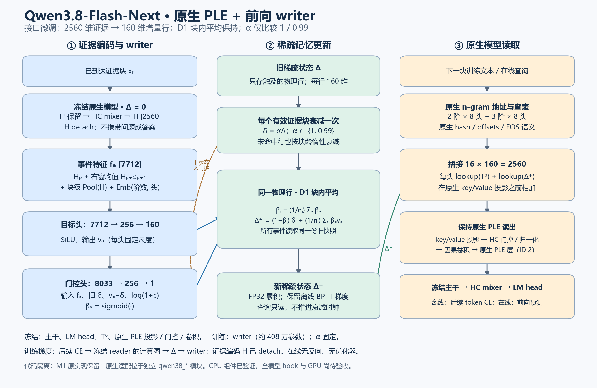

# Qwen3.8-Flash-Next：原生 PLE 与前向 writer

2026-10-20。范围：按用户决定，仅适配原生 Qwen3.8-Flash-Next，α 只保留固定 1 与 0.99；保留 D1 块内平均，调整 writer 的维度、头身份和尺度接口。

**当前状态：代码组件与 CPU 正确性已验证；完整原生模型的 hook、分布式梯度与真实读出扰动尚未验收。本文的结构选择是实现方案，尚无原生训练收益结果。**

**代码隔离：已训练 M1 使用的 `writer.py`、`batching.py`、`alpha_memory.py` 保持原版本。原生 writer、地址适配、PLE hook 和梯度桥分别位于 `qwen38_writer.py`、`qwen38_native.py`、`qwen38_adapter.py`、`qwen38_training.py`。四卡运行入口独立放在 `scripts/native_qwen38/`。**

## 1. 架构图

[可编辑 SVG](figures/qwen38_delta_writer_architecture_20261020.svg)

读图顺序：

1. 证据已经完整到达后，用保留基表 T⁰、清空在线增量 Δ 的冻结模型编码。writer 只接收这份证据的隐状态。
2. 每个 `(token 位置, n-gram 阶数, 哈希头)` 形成一个写入事件。目标头提出 160 维行目标，门控根据证据、旧状态与残差决定写入强度。
3. 相同物理行的事件共用块前快照，取平均完成 D1 更新。跨样本状态隔离。
4. 后续文本用原生地址读出 `T⁰ + Δ`，再经过原生 PLE 的投影、门控、归一化与因果卷积。empty 条件仅清空 Δ。

图中的读出分支按数据依赖简化：PLE 门控还读取注入层当前的 HC 残差状态。所有模型权重冻结，离线训练仍需保留 **loss → reader 计算图 → Δ → writer** 的梯度；不能把整个读取前向放进 `no_grad()`。在线使用只执行前向写入与读取。

## 2. 本次微调的精确规格

| 项目 | 原生适配 |
|---|---|
| 模型 | `Qwen/Qwen3.8-Flash-Next`，项目登记 revision `de4b8e4d43b917e7706784d8bb445c9af86a3540`；运行时另核对权重指纹 |
| writer 输入 H | HC mixer 收缩后、LM head 之前的 2560 维张量，detach |
| writer 输入归一化 | 参数无关 RMSNorm，epsilon=1e-6；两条 α 分支共用 |
| HC 残差宽度 | `4 × 2560 = 10240`；不能误作 writer 输入 |
| 特殊点 | 该模型没有独立 final layernorm；HC norms 与 mixer 承担末端处理 |
| 原生 PLE | config 中 `ple_layer_ids=[2]` |
| 地址与行宽 | 2 阶、3 阶各 8 头，共 16 头；每行 160 维；原生 offsets/sizes/哈希与 EOS 语义保持 |
| 事件特征 | `H_p ; mean(H_{p+1:p+4}) ; Pool(H) ; Emb(n,h)`，`3×2560+32=7712` 维 |
| 目标头 | `7712 → 256 → SiLU → 160`，按头乘固定尺度 |
| 门控头 | `[特征; δ̃; v−δ̃; log(1+c)]` 共 `7712+320+1=8033` 维；`8033 → 256 → SiLU → 1 → sigmoid` |
| writer 参数数 | **4,075,681**，两条 α 分支使用相同初始化；每头尺度是 buffer，不是训练参数 |
| 保留的选择 | 右窗 4、单查询块池化、最后一层特征。它们仍是未完成结构消融的选择 |
| α | 固定 1 或 0.99；每个包含新证据的有效块推进一次；查询与纯 padding 不推进 |
| 更新精度 | 稀疏 Δ 与 D1 累积为 FP32；读取时与已反量化 T⁰ 相加，再按原生路径的 dtype 继续 |

**地址不能直接沿用小模型外置表的约定。** 原生行号 0 有效；现有稀疏状态用 0 表示 padding。因此接口将有效原生 ID 映射为 `state_id = native_id + 1`，仅 mask 无效位置映射为 0。头区间从原生 checkpoint 的 buffers 提供，不能改用外置 hash 或假定每头都是完全相同的素数表长。

多个头的原生地址区间不重叠；同一头内多次命中同一物理行才在该块中聚合。批量训练额外按样本隔离状态命名空间。

### 共享证据投影，减少多头重复计算

16 个头共享同一位置的 `e=[H;right;pool]`。首层线性可以写为 `W_e e + W_h Emb(n,h) + b`；门控再加状态特征投影。原生实现每 token 计算一次大维度证据投影，再分配给各头，避免把 7680 维证据复制 16 份并重复做同样的首层投影。目标头与门控头各自保留自己的 W_e，没有共享两网络的参数。

这是同一参数化的执行优化。改变了浮点加法与矩阵乘法的分组，因此按容差检验数值及两块反传的等价，不宣称 bitwise 相同或未经实测的 GPU 加速倍数。该路径只存在于独立原生原型中。

### 初始尺度如何确定

保留目标末层小非零初始化与约 0.05 的初始门控。新增的 `calibrate_qwen38_target_scale` 在优化开始前，使用已到达证据 H 及实际基表的每头 RMS：

\[
s_h^{new}=s_h^{old}\,
\frac{\rho\,\operatorname{RMS}(T^0_h)}
     {\operatorname{RMS}(v_h)}.
\]

它令这批校准证据上的目标 RMS 等于基表 RMS 的指定比例 ρ；不读取后续答案。T⁰ 使用实际有效行值：本次固定 revision 的 PLE 权重已核实为 BF16，可直接计算；量化 checkpoint 才需要先反量化并应用其 scale。ρ 必须在优化前登记。本次真实训练侧观测后的短测候选固定为 `0.01`，仍须通过初始扰动和梯度检查。

这只校准**目标向量尺度**。D1 的实际首块变化还乘门控，并对碰撞事件平均；原生 key normalization、门控和卷积又会改变响应。因此还需测量真实 PLE 输出增量与初始 Δ_empty，不能把目标 RMS 比例等同于主干扰动比例。两条 α 分支必须共享同一校准结果。

## 3. 对原评议的数学核对

### 3.1 128 隐层确实限制单行写入方向，但“整个记忆只有 128 维”不准确

固定一个 writer checkpoint，其目标可写为：

\[
v_a=Wz_a+b,\qquad W\in\mathbb R^{1024\times128}.
\]

所有目标处于 `b + col(W)`，仿射维数至多 128。对 α=1 的 D1，

\[
\Delta'_j=(1-\bar\beta_j)\Delta_j+
W\left(\frac1{n_j}\sum_a\beta_a z_a\right)+\bar\beta_j b.
\]

从 Δ=0 出发，归纳可得每行 `Δ_j = Wq_j + s_j b`，其中

\[
q'_j=(1-\bar\beta_j)q_j+\tfrac1{n_j}\sum_a\beta_a z_a,\qquad
s'_j=(1-\bar\beta_j)s_j+\bar\beta_j.
\]

所以每行 Δ 的线性张成维数至多 **129**，而非必然 128。固定 α 衰减只是额外的标量乘法，不改变这个张成空间结论。每行有各自的系数；原生基表、多个行的组合以及非线性 reader 也都不受“整个记忆只有 128 维”的说法概括。

已对 M1 100M checkpoint 作 CPU SVD：`rank(W)=128`，`rank([W,b])=129`，偏置在 W 列空间外的范数约 **0.416894**。这证明该 checkpoint 存在单行输出方向限制，**没有证明它就是原样复述较弱的原因**。

原生行宽降为 160 后，选隐层 256，使输出矩阵为 `160×256`。只要矩阵满行秩，这个显式末层秩瓶颈即可去掉；CPU 初始化检查得到秩 160。它不保证所有 160 维目标都可由证据特征实际到达，也不证明训练不会出现其他表达或优化瓶颈。

### 3.2 D1 保证的是条件前向有界，不是完整状态 Jacobian 收缩

同一行每块命中 n 次，先按 α 衰减为 `δ̃=αΔ`，再更新：

\[
\Delta'=(1-\bar\beta)\tilde\delta+
\frac1n\sum_{a=1}^n\beta_a v_a,\qquad
\bar\beta=\frac1n\sum_a\beta_a\in[0,1].
\]

它是旧状态与目标的凸组合。若所有目标范数被同一个常数约束，且 α∈[0,1]，任何一步状态范数都不超过初始状态与历史目标范数的最大值。这个结论针对固定模型下的前向轨迹；训练不断改变目标网络时，仍需另行监测目标与梯度。

块内求和会失去该性质：20 个 β=0.25 的事件会令旧值系数成为 `1−5=−4`。反复作用于固定目标会放大误差。块内平均纠正的是重复命中的聚合强度；one-hot key 自身已满足二范数为 1，不能把平均严格等同于 key 的 L2 normalization。

writer 的目标只依赖未打补丁的 H，但门控读取旧 Δ，因此状态反馈仍存在。取 α=1，目标对 Δ 独立时：

\[
\frac{\partial\Delta'}{\partial\Delta}
=(1-\bar\beta)I+
\frac1n\sum_a(v_a-\Delta)(\nabla_\Delta\beta_a)^\top.
\]

反例：标量目标 v=1、β(Δ)=sigmoid(4Δ)。在 Δ=0 处导数为 `0.5+1=1.5`，尽管从 `[0,1]` 内开始的状态仍留在该区间。因此评议中“没有自激回路”应具体改为：**排除了 Δ → 被打补丁 H → writer 特征这条反馈；门控的状态反馈保留。** 梯度裁剪与裁剪前范数记录仍有必要。

### 3.3 有限步 oracle 不能直接充当性能上界

若优化器在可行集合 S 内只找到一个 patch，得到的只是一个可行解。就最小化 NLL 而言，其值不低于 S 上的全局最优值；就收益而言，它只证明“至少找到了这些收益”，不能证明“最多只能得到这些收益”。

只有**同一目标、同一评测信息与约束下**，并且 S 包含 writer 全部可达状态时，S 上的理论全局最优性能才能作上界。非凸优化的有限步结果不满足“已找到全局最优”这一条件。

所以“oracle 收益小，因此改 writer 没用”应撤回；低收益可能来自读出/容量，也可能来自步长、优化时长、梯度链路或约束。原计划已要求区别目标监督 oracle 与仅证据基线；目标监督版本额外读取答案，不能作为可部署记忆性能。该说明沿用现有诊断预算，不启动新实验。

## 4. α 的解释与本轮范围

原评议“衰减比较必须同时报告 Δ_empty 与 Δ_donor，并检查跨文章首块”这一要求成立。对已完成小模型结果，还应更正：

- 可学习全局 α 最终为 **0.9896329784**，210 步；“86 步约 0.98985”是中间记录。变化小，但不能写成没有移动或严格等同固定 0.99。
- 证据 α 末段按有效 owner-block 加权均值约 **0.3823**，书籍约 **0.1867**。变 α 的真实衰减取决于乘积，不能把算术均值代入半衰期后就断言只记上一块。
- 证据 α 相比 D1 的 self NLL 变差约 **0.00173665**，donor NLL 变差约 **0.01557115**；Δ_donor 的增大不能直接称作记忆更好。但 writer 与 α 共同训练，单凭这些差异还不能识别“因为 donor 被忘掉”的因果机制。
- 两种方法、各一个训练种子的分数差不是训练随机噪声估计；family bootstrap 也不包含跨训练种子的方差。

本轮按用户决定只保留原生固定 α=1/0.99，以上是对既有证据的解释更正。

## 5. 实现、验证与边界

已落地：

- [qwen38_writer.py](../../../src/delta_ngram/qwen38_writer.py)：独立原生 writer，输入维与行宽解耦、16 个 `(阶数,头)` 嵌入、固定每头尺度、按 token 共享证据投影。
- [qwen38_native.py](../../../src/delta_ngram/qwen38_native.py)：原生配置/地址校验、行号映射、`T⁰+Δ` lookup 边界、固定 α 工厂、尺度校准与独立 `write_native_block` 入口。
- 原生写入复用原有 `functional_d1` 和 `LazyDecayState`，保留同一块旧快照、样本隔离和惰性衰减语义；M1 的三个原文件保持原样。
- [测试](../../../tests/test_qwen38_native.py)：原生行 0、头区间、样本隔离、梯度、empty、固定衰减、尺度校准、旧参数兼容。
- [绘图脚本](../../../scripts/draw_qwen38_writer_architecture_20261020.py)：生成本页 PNG/SVG。

隔离后的相关 **94 项 CPU 测试通过**。包含已执行 D1 的 golden fixture：初始化 RNG、参数 keys/值、两次写入与梯度逐项一致；原生路径单独比较 dense concat reference 与共享投影的前向、参数梯度和旧状态梯度。完整模型运行没有包含在这些测试里。

2026-10-20 已在固定版本运行时的四张 H200 上完成原生接口预检：空状态保持原输出，原生地址/EOS 检查通过，梯度可经过 lookup overlay 返回。原生 TP scatter/gather 的两处伴随重建误差均为 0，应使用各 TP rank 上已完整的 replica 梯度，不再重复求和。真实 PLE 权重与输入的 12 个局部环节、3 个整链方向均通过 FP64 参考有限差分；原生 BF16 输入梯度与参考的相对 L2 误差约 0.006946，余弦约 0.999976。早先整模型 BF16 有限差分仍保留为未通过验收，不由参考结果替代。

两个独立问题已有定位与局部修复：grad/no_grad 的首个分叉位于 MoE router 按梯度模式改变的 top-k 排序；固定训练排序后，books 的四组 native/split、初始/零 Δ 条件及实际训练前向均达到逐位一致。初始小 Δ 的入口舍入通过独立 FP32 投影与相加修复，投影相加余弦超过 0.99999997；PLE 最终转回 BF16 仍有显著量化失真，不能称为全程保真。所有检查均关闭 PLE 融合核。最终选择 sorted router、eager HC、split PLE，证据、self、empty 与 probe 共用；优化前重新生成 H/每头尺度并完成 writer 与端到端方向核对。旧缓存仅作历史诊断。详见[数值审计](../../experiments/qwen38_native_20261020/numerical_runtime_audit_20261020.md)与 [native runtime guide](../../../scripts/native_qwen38/README.md)。

### 本地一手依据

- [实际模型 config](references/config.json)。
- [原生 PLE 源码](references/ple.py)：头数、行宽、地址区间、FP8 scale 与投影/门控/卷积。
- [模型转换源码](references/official_model_gpts_qwen4_exp.py)：无独立 final layernorm，末端 HC mixer。
- [原评议](references/delta_ngram_writer_review_20261020.md)；[既有原生诊断计划](../../training_plan_20261019.md)。
- [M1 输出秩实测](references/writer_output_rank_audit.json)。
