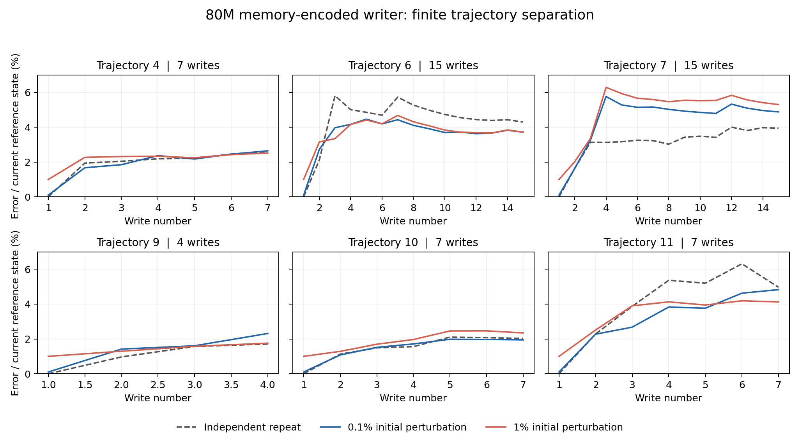

# Qwen3.8 记忆编码诊断与 80M→100M 分叉训练

更新：2026-10-21。最终执行决定：**取消残差组，只训练整体微调组（full）**，使用完整 4 卡。残差组标注为“**按用户决定提前停止，不作为结果**”。诊断用于解释训练结果，不作为额外开训门槛。

## 训练登记

- 起点：主线实际第 3,337 步、79,981,959 targets 的 80M checkpoint。
- full 重放主线后续 835 组，新增 20,015,113 targets，终点为实际 99,997,072 targets。
- full 训练原 writer，继承 80M AdamW 状态，学习率保持 3e-4。
- full 首组记录更新前实际 loss_sum、mean_nll 相对主线第 3,338 步的差，作为“切换为带记忆编码、尚未重训”的直接观测。主线 mean_nll 为 1.3320891617196364，30,186 targets；该差值不预设为零。
- 按用户后续确认，配对 loss **仅告警，由用户决定是否停止**：前 50 组仅观察，其后每 50 组计算 target 加权窗口，连续 3 窗口超过 +0.01 nats/target 发告警，不自动停训。每组、窗口及累计差均保存。
- 90M 永久保存最后不超过名义阈值的完整组节点：fork 第 417 组、模型第 3,754 步、实际 **89,977,396** targets；下一组会到 90,010,164。文件为 `branch-node-090000000.pt`。
- 诊断组保存真实训练 reference 与独立空状态重放的 repeat 轨迹，记录逐次写入、终态及末段变化；不声称所有轨迹已严格平台化。额外编码单独记账，新增 CE 为零。
- full 终点使用同一个不可变 `branch-terminal.pt`，独立执行两次完整 DEV64，分别记账、保存报告，列出两次 NLL/文档特有收益及其差异、相对主线差异。若与主线的差不超过两次实测范围，标为无结论；超过该范围也只算探索性结果，不能据两次运行推断统计显著性。
- G 及其阈值只用于监测，超过 1 不自动停训；非有限数、身份或预算不一致仍作为运行错误处理。

full 新进程于北京时间 **13:27:29** 启动，使用新冻结代码与重新通过 835 组校验的 full_spec，代码 manifest SHA256 为 `85262e2614b7a0e684332cb8f2aeab1671a179372a3a75fe0dae006c3543ef6f`。停止文件显式配置为 full 输出目录下的 `stop-after-group`，代码另有默认路径兜底。**启动回执已保存前 7 组真实优化器更新和 checkpoint 记录**；首步 10 个 AdamW 参数计数全部从 3,337 递增至 3,338。

full 首组更新前 NLL 为 **1.332474806812185**，主线第 3,338 步为 **1.3320891617196364**，差 **+0.00038564509254856993/token**；loss_sum 为 40222.08451843262，对比 40210.443435668945，差 11.641082763671875，覆盖完全相同的 30,186 targets。该观测是切换编码后、尚未更新 writer 的直接执行结果，含当前运行的数值变化，不能单凭一组推断收益。

首个 full 诊断组有 12 条轨迹、61 次写入；6 条多写入轨迹的独立 repeat 终态相对差中位 **3.31%**、最大 **5.28%**。G 中位 0.3027、p99 0.5609、最大 0.5859。诊断增加 30 次编码、73,782 真实输入 tokens、117,760 padded tokens，CE 为零；该组实际训练编码为 15 次、36,891 真实输入 tokens、58,880 padded tokens。

### 已终止的残差初始化记录

残差原启动命令遗漏了停止文件参数，因此放置文件不能让旧进程正常退出。披露这一遗漏后，用户明确授权“直接杀吧”；随后发送 SIGTERM，未伪称 stop-file 正常退出。最终保留 **77 个完整组、1,839,254 个已完成 targets**，另保留未完成下一组的 **23 次编码、105,507 真实输入 tokens、138,240 padded tokens** 费用；该未完成组没有新增 CE targets。四卡已释放，永久保存 `branch-user-stopped-group-0077.pt`，原检查点、日志、账本及逐组配对 loss 全部保留。**按用户决定提前停止，不作为结果。**

首组实际 NLL **1.3322209946039631**，主线第 3,338 步为 **1.3320891617196364**，差 **+0.00013183288432672136**；loss_sum 分别为 40214.422943115234 与 40210.443435668945。**binary64 逐位比较不通过**，不能宣称逐位复现。残差输出头在首组前严格为零；同组身份、30,186 个 targets、H12/Q4 分批和聚合顺序已核对。额外编码调用、writer 更新交错顺序等是候选执行差异，当前未定位单一原因。

首组 raw gradient L2 为 **0.005237893590598826**。首组记录用于零初始化与执行路径核验，不能视为严格逐位相等的证明；第 2 组起残差权重已经更新，后续配对 loss 不再是纯零初始化比较。残差不进入终点方法优劣比较。

## 1. 独立重复与扰动轨迹：百分比更正

`repeat_error_to_signal` 不能解释为相对状态范数的比值。正确指标是 `repeat_error_over_reference`，转成百分比需乘以 100。

首轮 V1 六条多写入轨迹的独立重复终态相对误差为 **1.71%–4.97%**。补充 V2 的同类结果为 **1.68%–4.96%**，中位 **3.06%**，与两种初始扰动的终态误差处于同一量级。独立重复是自行演化的完整轨迹，不能作为每次调用的局部噪声底从扰动误差中相减。

有限的 15 次写入中没有看到无界放大；这支持启动训练，但不是训练稳定性证明，也不能断言六条轨迹都在第 2–3 次写入后完全不再增长。H 的梯度截断去除了经原生编码器回传的梯度路径，仍需观测实际 writer 训练。

## 2. 不带记忆编码的双轨迹对照

V2 的 base 两条轨迹独立执行 writer 更新，复用同一份无记忆 H12 编码缓存；没有再编码第二份 H12。memory 两条轨迹分别以各自写前状态进行记忆编码。

| 轨迹 | 写入次数 | memory repeat 终态相对误差 | base repeat 终态相对误差 |
|---|---:|---:|---:|
| 4 | 7 | 2.699% | 6.919×10⁻⁹ |
| 6 | 15 | 3.423% | 3.525×10⁻⁹ |
| 7 | 15 | 3.758% | 8.419×10⁻⁹ |
| 9 | 4 | 1.680% | 2.433×10⁻⁹ |
| 10 | 7 | 1.698% | 4.414×10⁻⁹ |
| 11 | 7 | 4.963% | 7.170×10⁻⁹ |

此对照表明，在本次执行中，加入记忆编码的双轨迹分离远大于共享固定 H12 的 writer 双轨迹分离。它不单独确定 MoE、稀疏更新或任何特定 kernel 为原因。

## 3. 残差差分中的 batch/lane 成分

比较三项：原 H12 base、与 memory 编码相同 batch/lane 的 matched base、memory 编码。定义 `batch_noise = matched_base − H12_base`，`matched_memory_delta = memory − matched_base`。

12 个空状态写块在 raw H、RMSNorm H、writer 特征三个空间的 matched memory delta **全部精确为零**。原 `memory − H12_base` 则全部非零，且完全等于 batch/lane 差分。writer 特征中这项差分的相对 L2 中位为 7.56%、最大为 10.90%。

49 个非空写块的 `‖batch_noise‖ / ‖matched_memory_delta‖`：

| 特征空间 | 中位数 | 最大值 |
|---|---:|---:|
| raw H | 0.323 | 0.430 |
| RMSNorm H | 0.339 | 0.458 |
| writer 特征 | 0.319 | 0.431 |

因此残差差分改用 matched base 有直接证据支持。此修正去除可见的 batch/lane 成分，但不能保证消除所有跨调用数值变化。

## 4. 功能影响：采用独立重复 NLL，不继续添加扰动

用户更正到达前，V2 已执行四个最终查询条件：memory_ref、memory_eps01、base_ref、base_eps01，各 3,050 targets，共 **12,200 CE targets**。memory 扰动减参考的 token 加权 NLL 为 +0.0005054，base 为 −0.0041146；这些是已发生的扰动比较，**不是独立重复 NLL**，不用于回答重复执行造成多少功能变化。

更正后的功能判据是：参考轨迹与独立重复轨迹最终记忆，对相同查询分别评分并比较 NLL。V2 未保存最终状态张量，因此该项需要单独重放参考/重复轨迹。最小 repeat-only 对照已通过 CPU 验证，现登记在 full 训练及其终点评估完成后使用同一 80M 源 checkpoint 执行，避免占用正在训练的 4 卡。新增预算为 32 次编码与 12,200 CE targets；不添加扰动，不作为开训门槛。结果产生前保持“未测”状态。

## 5. G 的分母与解释

V1 可评估写块 49 个，空状态过滤 12 个。G 中位 0.2969，p99 0.5651，最大 0.5943。分母 read-state L2 最小 7.30、中位 11.56、最大 16.37，远离 1e−8 的绝对 floor；没有证据支持本轮大 G 来自接近零的分母。G 与分母的 Pearson 相关为 −0.477，但不能据此将比率变化全部归于分母。

V2 在 H12 base-reference 状态轨迹上测得 G 中位 0.2956、p99 0.5520、最大 0.5668。V1 使用 matched-small-base 状态轨迹，两轮 G 的状态路径不同，不能当作完全相同条件的复测。

G 衡量固定直接状态输入时的编码替换敏感度，不是完整状态闭环的收缩系数。逐 row 增益的大值也不能直接解释为自环增益。

## 6. 执行与预算回执

| 执行 | 编码 collective calls | 编码真实 tokens | 编码 padded tokens | 查询 CE targets | backward / optimizer |
|---|---:|---:|---:|---:|---:|
| V1 前向诊断 | 90 | 221,346 | 353,280 | 0 | 0 / 0 |
| V2 补充诊断 | 92 | 258,237 | 396,800 | 12,200 | 0 / 0 |

V2 另有 4 次最终查询 collective，查询真实输入 15,272、padded 输入 20,480。V2 执行退出码为 0，四 rank RNG、原 writer 和源训练状态均保持不变。诊断区间 max-rank 时间为 67.27 秒；含模型初始化的运行区间 176.19 秒，4 卡占用计 0.19577 GPU-hours，不等于 kernel 活跃时间。

代码验证：首版相关 CPU 测试 130 项通过；用户更正后的双次 DEV64/首步核对相关 66 项通过，并完成只读审计。GPU 是否已完成首组须看运行回执。

### 可追溯文件

- [V1 原始回执压包](data/qwen38_memory_forward_20261021.zip)，SHA256 `daa5d12630542534276b8e21241c9fd917f926ddecd439d85c9c1602d407dfe5`。
- [V1 分析 JSON](data/qwen38_memory_forward_analysis_20261021.json)。原始报告 SHA256 `2f0785464eb759ba7051c458326f18b40e69be165c9e57ba4d125563403be5e0`。
- [V2 原始回执压包](data/qwen38_memory_supplemental_20261021.zip)，SHA256 `09f3d9f98d901c15d4f009cfbbbfd2a80598ccdb83ce057f548cdf89740fc0a2`。
- [V2 原始报告](data/qwen38_memory_supplemental_20261021/native_memory_supplemental_probe_01/report.json)，SHA256 `031f55fb23e6a616ca8a2e6cd0b3b6a5b076a0e064c9bb8c45ab361d832561ab`。
- [V2 独立统计](data/qwen38_memory_supplemental_analysis_20261021.json)，SHA256 `67bd684876a3230fc2b9df6736460cbdc25e8394fef895c977456709b7466e6f`。
- [训练启动回执](data/qwen38_memory_training_startup_20261021/memory_startup_receipt_20261021.json)与[完整启动回执压包](data/qwen38_memory_training_startup_20261021.zip)，压包 SHA256 `ad87bcdb242bdd1a462a8f6d69060ad58a1a04ccaca4a8cab7443bccc89ed54e`。
- [full-only 启动及残差停止回执](data/qwen38_memory_full_only_startup_20261021/full_only_startup_receipt_20261021.json)与[压包](data/qwen38_memory_full_only_startup_20261021.zip)，压包 SHA256 `12790da89d162c8937c2dfc6d0500cdc8023cf9ed0091758352b132401956a69`。
- [残差 77 组配对 loss](data/qwen38_memory_full_only_startup_20261021/native_memory_residual_01/paired-loss-records.json)，仅第一组为零初始化比较。
- source80 checkpoint SHA256：`c24b4342c51a072227aa90c8aa370f666626734bd8a5f6ea393598be3f9d59cb`。
- 不覆盖主线目录；训练输入、源代码冻结和输出均位于远端 `/workspace/delta-ngram-memory-fork-20261021/`。

## 7. 关于取消残差的数学解释

预算与部署成本支持取消本次残差训练，但不能据此断言残差结构在数学上不成立或不能部署。以下按实际 native 代码，而非另一个带 tanh target 的假设模型推导。

### 实际残差输出不是纯自引用项

令 $x_b$ 为原 base writer 特征，$d(s)=x_{mem}(s)-x_{matched}$ 为匹配 batch/lane 后的特征差。当前实现输出 target 与 gate-logit 两种残差：

$$v(s)=v_0(x_b)+D_{scale}r_v(x_b,d(s)),$$
$$\beta(s)=\sigma\left(g_0(x_b,s)+r_g(x_b,d(s))\right).$$

其中 $g_0$ 已含旧状态、$v_0-s$ 与计数特征；base gate 不会重新把修正后的 $v$ 作为误差输入。target 是线性末层输出乘 scale，**没有 tanh**；只有 gate 使用 sigmoid。

一般可以恒等分解

$$R(x_b,d)=R(x_b,0)+\left[R(x_b,d)-R(x_b,0)\right].$$

只有方括号这一项在 $d=0$ 时必为零。实际网络没有强制 $R(x_b,0)=0$，可以通过 base 输入学习与记忆差分无关的修正。因此它没有把所有可训练容量都限制在“把记忆痕迹写回去”上，也不是严格的自引用归因工具。

零初始化末层保证初始 $R\equiv0$ 和初始输入 Jacobian 为零，但末层参数梯度通常非零；“差分没有用”并不意味着网络必须留在零附近。冻结 base gate 参数也不意味着门控对状态的最终响应完全固定：额外 logit 会改变 sigmoid 的工作区间，$d(s)$ 又引入间接状态依赖。受限的是任意重学显式旧状态交互的能力。

### 带记忆目标仍可作 delta-style 更新，但需要重新分析稳定性

实际 D1 对物理行 $j$ 的更新是

$$T_j(s)=s_j+\frac1{m_j}\sum_{e\to j}\beta_e(s)\left[v_e(s)-s_j\right].$$

因此 $v$ 依赖旧状态，并没有消除这条误差校正形式；它引入了状态反馈，使固定外生目标下的结论不能直接沿用。与输入仅决定 $v,k,\beta$ 的简化 DeltaNet 公式相比，我们原来的 base gate 本就显式依赖旧状态和计数，不能将二者无条件等同。

为看清新增项，考虑冻结证据、地址与计数的单事件局部理想化：

$$T(s)=s+\beta(s)(v(s)-s),$$
$$DT(s)=(1-\beta)I+\beta Dv+(v-s)(\nabla\beta)^\top.$$

在 $v(s^*)=s^*$ 且 $\beta>0$ 的固定点，简化为

$$DT(s^*)=(1-\beta)I+\beta Dv(s^*).$$

外生固定目标对应 $Dv=0$；记忆编码引入 $Dv\ne0$。这既可能改善写入，也可能产生放大，不能仅凭 $0<\beta<1$ 保证收缩。多事件聚合的固定点只要求加权残差之和为零，各 gate 导数项未必消失。真实训练中证据和计数继续变化，上述固定点推导只是冻结这些量后的局部解释。

计算是先用旧状态求 $H_{mem}$、再写新状态的显式因果过程，并不需要在每一步求解隐式自洽方程。编码器 detach 只切断训练反传路径，**不会删除真实前向的状态反馈**。由此不能推出“数学上不能部署”或“detach 后必然稳定”。

### 成本与证据边界

- 当前 full 非诊断组只执行 Hmem evidence 编码，没有无用 H12 预取。诊断组额外执行 matched-base 与独立 repeat，分别记账。
- 残差至少需要 base 与 memory 两类特征；本次为兼容主线 H12 又消除 batch/lane 混入，训练实际保留 H12、matched base、memory 三条编码流。它的额外成本是取消本次分支的直接理由。
- full 不必额外保留 base 编码流，但当前代码仍显式进行 evidence 前向，**尚未实现免费复用 generation forward**。复用需相同 tokens、前缀/位置/attention、写前记忆状态及 hidden 提取边界；writer 需要整块 pooling/right-context，写入时机也必须匹配。一般 generation KV cache 不自动满足这些条件。
- 双轨迹分离与 batch/lane 敏感性是已测现象；“路由翻转主导差分”尚未由固定路由或贡献分解实验确认。
- 首组 full 配对 loss 衡量本次执行中“换编码、未更新 writer”的效果；后续曲线同时包含 writer 重训。它们不能单独分离“记忆信息有用”与其他结构/数值影响。残差首组 $1.318\times10^{-4}$ 的差是实测值，是否落在独立重复 NLL 的范围内，需要该 NLL 对照，不能由状态范数百分比直接换算。
