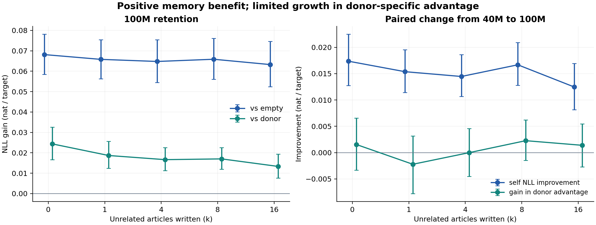
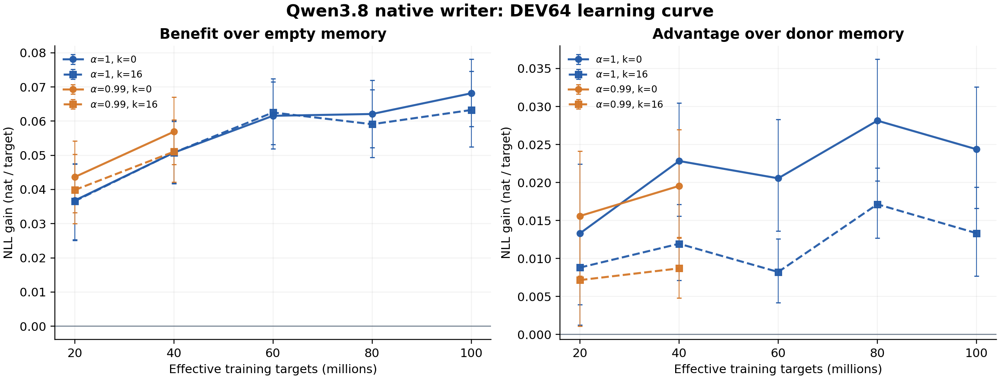

# Qwen3.8 原生写入器 100M 训练评估报告

2026年10月21日｜评估范围为 DEV64 开发集｜北京时间

## 结论

**训练已正常结束。α=1 的最终有效训练量为 99,997,072 targets，共 4,172 步；100M 节点的 DEV64 已完成 64/64 个事件家族，作业于 10:37:39 正常退出。** 最后剩余 2,928 targets，不足以下一个完整组的 22,528 targets，符合登记的整组预算边界。监测已停用。

- **记忆收益成立。** 最终模型在全部五个干扰距离下，self 都优于 empty 和 donor，家族配对 bootstrap 的逐项95%区间均高于零。
- **从40M继续训练到100M，self 的预测损失进一步下降；事件专属优势的增量没有同样明确。** k=0 的 Δ_empty 增加0.01737，k=16增加0.01247；对应 Δ_donor 增量的区间均跨零。donor 路径也随训练改善，因此不能将全部收益归为更强的事件记忆。
- **同预算结果不支持笼统宣称 α=1 更好。** 在共同的20M、40M节点，α=.99在k=0的自身预测收益更高；k=16的两者差异及donor优势差异均未明确分离。
- **16篇干扰后仍有收益，但存在衰减。** 100M 的 Δ_empty 从0.06815降至0.06326，Δ_donor从0.02437降至0.01333。
- **这是探索性开发集证据。** 单训练seed、未做多重比较校正；封存的 FINAL 未使用，结果不是答题正确率或修订成功率。

## 完成状态与核验

| 项目 | 最终结果 |
|---|---:|
| α=1 有效训练 targets | 99,997,072 |
| α=1 更新步数 | 4,172 |
| α=.99 有效训练 targets | 39,998,107 |
| α=.99 更新步数 | 1,669，完整状态与接力前一致 |
| 完整 DEV64 节点 | α=1：20/40/60/80/100M；α=.99：20/40M |
| 每个节点覆盖 | 64家族 × 5距离，320个唯一家族与距离组合 |
| 每个节点评测访问 | 2,197,313 CE targets |
| 事件桶最大抽样轮数 | 2.70732，低于3 |
| 事件桶最大token消费重复倍数 | 2.68556，低于3 |
| 进程退出 | 返回码0，训练及接力监控进程均已退出 |

七份报告的文件哈希和登记的结构哈希均通过；最终检查点文件哈希通过；α=.99的writer、AdamW、sampler、各rank RNG及稳定性状态的整体摘要保持一致。所有节点评测均无反向传播和优化器更新，评测后恢复训练RNG。

## 评测口径

训练时冻结reader，仅更新D1 writer，使用无参数RMSNorm与固定校准scale（ρ=0.01）。两支从同一seed17初始writer出发；AdamW学习率3e-4、weight decay为0、L2梯度裁剪阈值1。每个更新组包含12条完整轨迹，保留完整BPTT；四卡EP4/DP4，证据编码批上限12、查询微批上限4（H12/Q4）。

每个事件家族使用早期文章构造记忆，并对后来文章进行 teacher-forced 续写评分。self写入本事件早期文章；donor写入指定的其他事件文章。只有self和donor随后继续写入k=0、1、4、8、16篇干扰文章；empty始终为空，其评分在各k复用。k是文章数，不是写入块数或衰减次数。后来文章用于评分，不写回记忆。

主指标为家族等权的 `Δ_empty = NLL(empty) − NLL(self)` 与 `Δ_donor = NLL(donor) − NLL(self)`，单位nat/目标token，正值表示self更好。每家族内部先平均目标token损失，再对64个家族等权；这与token加权汇总不同。donor对照用于分离与本事件相关的额外收益，但两条锚点文章长度并不完全相同。

本文对保存的逐家族结果统一重算10,000次配对bootstrap，seed=20261019。跨节点以同一事件家族和距离对齐，并用同一批家族重采样索引计算差值区间；不把320行或三个方向置换seed当作独立样本。区间为逐项95%百分位区间，未校正多重比较，也不覆盖训练seed间的不确定性。

## 最终100M节点表现

| 干扰文章数k | Δ_empty及95%区间 | Δ_donor及95%区间 | self NLL |
|---:|---:|---:|---:|
| 0 | 0.06815 [0.05844, 0.07814] | 0.02437 [0.01660, 0.03259] | 1.77275 |
| 1 | 0.06581 [0.05624, 0.07543] | 0.01868 [0.01239, 0.02561] | 1.77509 |
| 4 | 0.06478 [0.05448, 0.07541] | 0.01665 [0.01132, 0.02256] | 1.77612 |
| 8 | 0.06586 [0.05606, 0.07606] | 0.01702 [0.01193, 0.02251] | 1.77504 |
| 16 | 0.06326 [0.05244, 0.07459] | 0.01333 [0.00768, 0.01940] | 1.77765 |

empty NLL在各距离均为1.84090。k=0时self为1.77275、donor为1.79713；k=16时self为1.77765、donor为1.79098。远端的donor优势下降，既包含self变差，也包含donor在干扰写入后改善。

同一家族内k=16减k=0：Δ_empty变化为 **-0.00489 [-0.01005, -0.00012]**，Δ_donor变化为 **-0.01104 [-0.01936, -0.00307]**。按点估计，远端保留约92.8%的empty收益、54.7%的donor优势。这是家族平均收益之比，并非逐家族保留率的平均值；比例未计算置信区间，仅作描述性摘要。

## 继续训练带来了什么

### α=1学习曲线

| 名义节点 | 实际targets | k=0 Δ_empty | k=16 Δ_empty | k=0 Δ_donor | k=16 Δ_donor |
|---:|---:|---:|---:|---:|---:|
| 20M | 19,981,748 | 0.03676 | 0.03657 | 0.01330 | 0.00881 |
| 40M | 39,998,107 | 0.05078 | 0.05079 | 0.02283 | 0.01194 |
| 60M | 59,979,219 | 0.06155 | 0.06253 | 0.02055 | 0.00823 |
| 80M | 79,981,959 | 0.06208 | 0.05909 | 0.02814 | 0.01714 |
| 100M | 99,997,072 | 0.06815 | 0.06326 | 0.02437 | 0.01333 |

### 配对增量

下面的区间针对同一家族的节点差值计算。self NLL改善为旧节点损失减新节点损失，正值表示改善；Δ_donor增量为新节点优势减旧节点优势。

| 比较 | k | self NLL改善及95%区间 | Δ_donor增量及95%区间 |
|---|---:|---:|---:|
| 40M→100M | 0 | +0.01737 [0.01276, 0.02250] | +0.00154 [-0.00334, 0.00655] |
| 40M→100M | 16 | +0.01247 [0.00814, 0.01693] | +0.00139 [-0.00270, 0.00547] |
| 60M→100M | 0 | +0.00659 [0.00324, 0.00992] | +0.00382 [-0.00076, 0.00887] |
| 60M→100M | 16 | +0.00073 [-0.00384, 0.00495] | +0.00511 [0.00101, 0.00945] |
| 80M→100M | 0 | +0.00606 [0.00227, 0.01012] | -0.00377 [-0.00831, 0.00075] |
| 80M→100M | 16 | +0.00416 [-0.00052, 0.00856] | -0.00381 [-0.00855, 0.00076] |

40M→100M在全部五个距离都有明确的self损失下降，全部五个Δ_donor增量区间则均跨零。两个端点的donor NLL也分别改善0.01583、0.01107，因而相对donor的增量较小。80M→100M在k=0、1、4、8有明确的self损失下降，k=16改善区间跨零。60M→100M的k=16自身损失几乎持平；该处donor优势增长的一部分来自donor损失变差。

因此，100M是完成登记预算的最终检查点，并在无干扰端点取得当前最高Δ_empty；不能据此宣称它在所有记忆指标上都是最优节点，也不能把donor差距变大自动解释成self学习更好。

## 两种α的同预算比较

α=.99停留在40M；公平的训练量对照仅覆盖20M、40M。两支共用初始writer和数据协议，但各自维护optimizer、sampler与RNG状态。

| 节点 | k | α=1 Δ_empty | α=.99 Δ_empty | 差值及95%区间 | Δ_donor差值及95%区间 |
|---:|---:|---:|---:|---:|---:|
| 20M | 0 | 0.03676 | 0.04364 | -0.00687 [-0.01109, -0.00297] | -0.00229 [-0.00695, 0.00226] |
| 20M | 16 | 0.03657 | 0.03984 | -0.00327 [-0.00759, 0.00093] | +0.00165 [-0.00256, 0.00565] |
| 40M | 0 | 0.05078 | 0.05690 | -0.00613 [-0.01011, -0.00241] | +0.00328 [-0.00148, 0.00784] |
| 40M | 16 | 0.05079 | 0.05105 | -0.00026 [-0.00450, 0.00402] | +0.00324 [-0.00046, 0.00703] |

差值为α=1减α=.99。在两个预算下，k=0、1、4、8均为α=.99的自身收益更高，差值区间不含零；k=16的自身收益差异未明确分离。表中四个同预算端点的donor优势差异区间均跨零。40M的k=1、8虽然α=1的donor优势更高，但其self和donor损失也都更高，不能据此声称预测更好。100M的α=1与40M的α=.99不构成等预算机制比较。

## 首评分窗口 分组与方向对照

### 跨文章首评分窗口

首评分窗口指后来文章提供128个上下文token之后，接下来的最多384个目标token；不是首个token，也不是512-token写入块。

| k | 首窗口Δ_empty及95%区间 | 首窗口Δ_donor及95%区间 |
|---:|---:|---:|
| 0 | 0.05154 [0.04156, 0.06239] | 0.01760 [0.01177, 0.02418] |
| 16 | 0.04622 [0.03502, 0.05832] | 0.01002 [0.00403, 0.01639] |

收益已出现在首评分窗口，并非全部来自后来文章已经展开后的上下文。

### 前缀是否复述早期事实

使用原生tokenizer对应的固定标注：34组已复述、23组未复述、7组未知。未知组保持独立，不能并入未复述。

| 分组 | 家族数 | k | Δ_empty及95%区间 | Δ_donor及95%区间 |
|---|---:|---:|---:|---:|
| 已复述 | 34 | 0 | 0.06506 [0.05288, 0.07700] | 0.02356 [0.01393, 0.03475] |
| 已复述 | 34 | 16 | 0.05936 [0.04574, 0.07273] | 0.01139 [0.00408, 0.01895] |
| 未复述 | 23 | 0 | 0.06923 [0.04946, 0.09040] | 0.02043 [0.00868, 0.03273] |
| 未复述 | 23 | 16 | 0.06525 [0.04374, 0.08907] | 0.01234 [0.00323, 0.02339] |
| 未知 | 7 | 0 | 0.07959 [0.06165, 0.09845] | 0.04129 [0.00913, 0.07522] |
| 未知 | 7 | 16 | 0.07560 [0.05302, 0.09689] | 0.02603 [0.00879, 0.04682] |

未复述组在k=16仍有正收益，首窗口Δ_donor为0.01127 [0.00095, 0.02352]。这支持收益不完全依赖于128-token前缀显式复述所标注的早期事实；不等价于证明模型从未见过事件，或排除了所有词面重叠。

### 21组具有明确修订关系的新闻对

固定标注包含13组状态更新、8组版本更新；不是21个错误事实纠正测试。

| k | Δ_empty及95%区间 | Δ_donor及95%区间 | 首窗口Δ_donor及95%区间 |
|---:|---:|---:|---:|
| 0 | 0.06957 [0.04778, 0.09175] | 0.02076 [0.01032, 0.03144] | 0.01693 [0.00777, 0.02647] |
| 16 | 0.07058 [0.04895, 0.09372] | 0.01585 [0.00524, 0.02844] | 0.01175 [0.00004, 0.02551] |

这些是后来文章的续写NLL，不是对新旧答案的强制选择，也没有执行“把修订文章写入后再检验旧记忆是否被改正”的流程。因此可说修订关系子集的总体续写收益为正，不能报告修订成功率或旧记忆纠错率。远端首窗口donor优势的下界接近零，应谨慎解读。

### 方向置换对照

方向收益定义为置换读出通道后的NLL减原方向NLL。三个固定置换seed先在家族内平均；置换只作用于评分读视图，后续写入保持原状态。

| k | self方向收益及95%区间 | donor方向收益及95%区间 | self减donor及95%区间 |
|---:|---:|---:|---:|
| 0 | 0.07273 [0.06324, 0.08267] | 0.04463 [0.03571, 0.05376] | 0.02810 [0.01982, 0.03683] |
| 16 | 0.06868 [0.05800, 0.07979] | 0.05151 [0.04257, 0.06082] | 0.01717 [0.01152, 0.02317] |

置换同时伤害self和donor，而self受到的额外损害更大。这支持原方向承载有用结构；它本身不是独立的事实正确率检验，也不应把置换破坏的全部损失都算作事件专属记忆。

## 实际消费与GPU占用

| 账目 | targets访问次数 |
|---|---:|
| α=1有效模型训练 | 99,997,072 |
| α=.99有效模型训练 | 39,998,107 |
| α=1历史优化消费 | 1,468,915 |
| 累计优化消费 | 141,464,094 |
| 累计独立评测访问 | 15,667,873 |
| 累计接口诊断访问 | 59,620 |
| 三类累计访问合计 | 157,191,587 |

最后一行是重复计算的访问次数合计，不是unique tokens，也不是模型有效训练量。此次接力新增有效训练41,486,567 targets，新增评测6,591,939；接力期间无未完成或失败的优化消费。历史及失败评测消费没有退款。

| GPU占用口径 | GPU·小时 | 范围 |
|---|---:|---|
| 旧作业完整进程寿命 | 28.965618 | 启动至观察到退出，包含加载、评测、保存与等待 |
| 接力作业完整进程寿命 | 15.752823 | 启动至退出 |
| 上述两个作业合计 | 44.718441 | 仅覆盖这两个进程区间 |
| 接力runner内部execute计时 | 15.685974 | 包含模型加载，不含此前CPU校验；与上一行相关区间重叠 |

**44.718441 GPU·小时不是全部历史成本。** 更早的首20M训练、试训、失败评测及其他诊断没有全部纳入这两个进程寿命。内部分类计时分别为训练12.943144、评测1.420876、检查点0.907620、其他0.462515 GPU·小时；每类独立取rank最大值，不能相加或当作严格可加的堆叠。所有这些都是占用时间，不是GPU内核活跃时间。

| α=1事件桶长度 | token消费重复倍数 | 抽样轮数 | 上限 |
|---:|---:|---:|---:|
| 4块 | 2.68556 | 2.70732 | 3 |
| 8块 | 2.46724 | 2.47255 | 3 |
| 16块 | 2.42385 | 2.40541 | 3 |
| 32块 | 2.43902 | 2.50000 | 3 |

## 证据边界与后续判断

当前结果支持：原生writer能够学到有用的写入，收益能跨越16篇干扰文章，且不完全依赖于前缀复述；继续训练改善了自身续写预测。尚不能据此确认α=1机制全面优于α=.99，或确认从40M到100M主要增强了事件专属记忆。

这一轮使用单模型、单训练seed和固定ρ=0.01。100M延长是在查看20M/40M开发集后登记的探索性续训；多个节点、距离和子集的比较未经多重校正。模型预训练截止日期未知，不能把这些新闻声明为必然未见。每条训练轨迹重置记忆，结果也不等价于一张记忆表跨所有SGD更新永久保持。

原生运行采用已登记的sorted router、HC eager、split PLE等路径，各条件共用相同实现。既有完整writer有限差分与端到端方向验收缺口、调度数值对照未过门槛的记录仍保留；本报告中的统计和产物完整性核验，不替代一般数值等价证明。

后续若评估带记忆编码writer，可使用已保存且包含完整续训状态的80M检查点，并以主线80→100M的相同完整轨迹组作对照。应先按审阅回应修订诊断协议，再登记新试验；本次评估没有启动新的GPU训练。对修订能力若要作更强结论，需要另设“更正证据写入后”的新旧事实判别任务。

## 数据与复算入口

- [七个节点的逐家族评测数据摘录](data/qwen38_native_100m_source_20261021.json)
- [统一配对统计结果](data/qwen38_native_100m_analysis_20261021.json)
- [检查点与最终运行核验](data/qwen38_native_100m_integrity_20261021.json)
- [CPU统计复算脚本](data/analyze_qwen38_native_100m_20261021.py)
- [图表与报告生成脚本](data/render_qwen38_native_100m_report_20261021.py)
- [带记忆编码方案的审阅回应](memory_aware_writer_stability_response_20261021.md)
- [原生续训登记](../qwen38_native_per_arm_extension_20261021.md)

数据摘录保留每份原始报告的远端路径、文件哈希和结构哈希、全部主统计与逐家族NLL；省略原文及不参与本次统计的明细。最终检查点文件SHA256为 `523b951487cee0ec726077db0104a8fc929f4629bdb4ca46604295a4b78fbfe3`。

