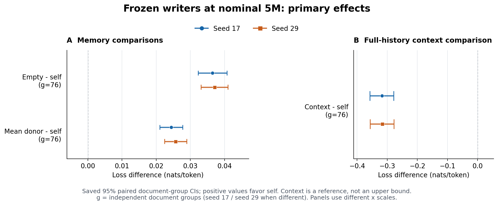
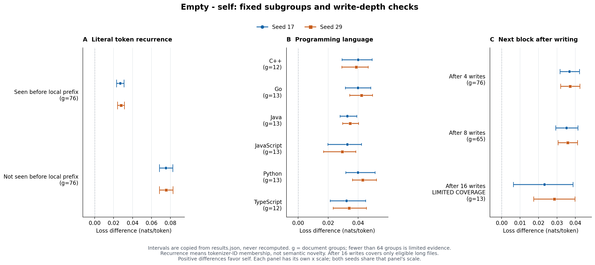
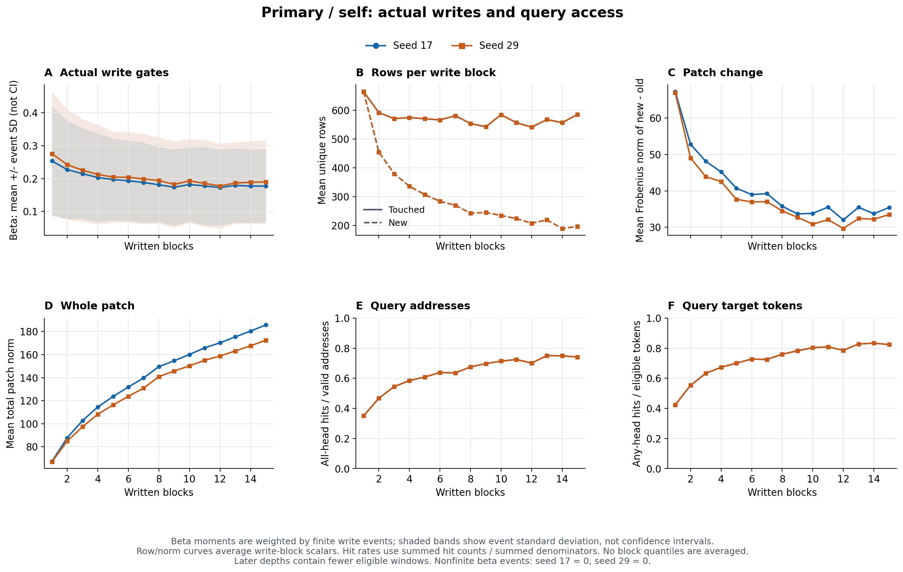

# P1 两个种子的固定开发集诊断

2026 年 10 月 19 日。使用 seed17 和 seed29 的名义 5M checkpoint，实际均为第 256 步、4,997,632 个训练 loss tokens。P2 和 P3 保持暂停。

两个种子的 Δ_donor 均为正，95% 文档组配对 CI 均不跨零，支持当前开发集上使用目标自身历史的额外收益。异文档 donor 也优于 empty，因此不能把全部 Δ_empty 都归因于文档特异信息。排除训练 split donor 的敏感性分析保持同一方向。

完整真实上下文的 NLL 为 0.814597，明显低于两个 self 条件。以 empty 到 context 的损失差为分母，self 分别收回 10.3% 和 10.5%（点估计；输入预算不同）。六语言与两个复现桶的 Δ_empty 点估计均为正；写入 16 块后的结果仅覆盖 13 个文档组。

## 评测范围与统计口径

两种子使用同一开发集的 111 个窗口、76 个文档组、463,360 个评分 tokens。每个目标固定两个同语言 donor，文档长度比限定在 0.5–2，target 与两个 donor 的已检测家族互不相同。222 个 donor 槽位中有 2 个来自训练 split；其余来自开发 split，同时报告两个 donor 均来自开发集的 109 窗口敏感性分析。

所有条件均冻结参数、batch size 为 1、逐窗口重置状态。self、empty、donor 均以当前评分块之前的 128-token 局部历史和当前块作为 reader 输入，按因果 next-token 计分；context 使用窗口内完整真实历史和当前块，保持空补丁。先评分，再写当前块；donor 只写 donor 的历史。单块为 512 tokens。

以下损失单位均为 nats/token。Δ_empty = L_empty − L_self；Δ_donor = (L_donor1 + L_donor2)/2 − L_self。正值表示 self 更好。95% CI 使用 2,000 次固定种子文档组配对 bootstrap；各组携带所有条件一起重采样，按 loss sums / token counts 计算。分桶 CI 未做多重比较校正，少于 64 个组的结果仅作描述。

## 整体损失与配对差值

| 条件 | seed17 NLL | seed29 NLL |
| --- | --- | --- |
| self | 1.131834 | 1.131207 |
| empty | 1.168260 | 1.168260 |
| donor_1 | 1.156093 | 1.156876 |
| donor_2 | 1.156373 | 1.156909 |
| donor_mean | 1.156233 | 1.156892 |
| context | 0.814597 | 0.814597 |

| 配对差值 | seed17 差值 [95% CI] | seed29 差值 [95% CI] |
| --- | --- | --- |
| delta_empty | 0.036427 [0.032267, 0.040708] | 0.037053 [0.033104, 0.040988] |
| delta_donor | 0.024399 [0.021084, 0.027733] | 0.025685 [0.022446, 0.028903] |
| delta_donor_1 | 0.024259 [0.020631, 0.027987] | 0.025669 [0.021982, 0.029271] |
| delta_donor_2 | 0.024539 [0.021251, 0.028025] | 0.025702 [0.022644, 0.028930] |
| delta_context | -0.317237 [-0.357688, -0.278688] | -0.316610 [-0.357001, -0.278081] |
| empty_minus_context | 0.353663 [0.313520, 0.396588] | 0.353663 [0.313520, 0.396588] |

delta_context = L_context − L_self；负值表示 context 更好。context 使用更多输入 tokens，属于额外上下文参照。

| 开发集 donor 敏感性分析 | 窗口 | 文档组 | 评分 tokens | Δ_donor [95% CI] |
| --- | --- | --- | --- | --- |
| seed17 | 109 | 76 | 448000 | 0.024735 [0.021509, 0.028018] |
| seed29 | 109 | 76 | 448000 | 0.025964 [0.022779, 0.029130] |

原 P1 评测按文档组最多 batch 4；本次统一 batch 1，并逐 token 收集损失。下表仅表示计算批形状与求和方式造成的数值差异。

| 种子 | self NLL 差值 | empty NLL 差值 |
| --- | --- | --- |
| 17 | -0.000102752136 | -1.63039546e-05 |
| 29 | 4.21726367e-05 | -1.63039546e-05 |

## 历史 token 复现分桶

以每一评分块开始时为边界，检查目标 token ID 是否出现在已写历史中、且位于直接可见的 128-token prefix 之前；排除当前块与未来内容。这是 tokenizer ID 的字面复现。

| 桶 | 文档组 | 评分 tokens | seed17 Δ_empty [95% CI] | seed29 Δ_empty [95% CI] |
| --- | --- | --- | --- | --- |
| 128-token prefix 以外出现过 | 76 | 372964 | 0.027034 [0.023103, 0.031009] | 0.027780 [0.024170, 0.031301] |
| 128-token prefix 以外没出现过 | 76 | 90396 | 0.075179 [0.068376, 0.082377] | 0.075316 [0.068267, 0.082610] |

未复现桶的 empty NLL 为 2.264555，已复现桶为 0.902549。两桶的预测难度与组成不同；较大的绝对 Δ 不能直接解释成语义记忆。目标 token 仍可能出现在直接可见的 128-token prefix 中。

## 编程语言分桶

| 语言 | 文档组 | 评分 tokens | seed17 Δ_empty [95% CI] | seed29 Δ_empty [95% CI] |
| --- | --- | --- | --- | --- |
| cpp | 12 | 80384 | 0.039915 [0.029147, 0.049293] | 0.038610 [0.029049, 0.046686] |
| go | 13 | 80384 | 0.039865 [0.031365, 0.048324] | 0.042109 [0.034336, 0.049560] |
| java | 13 | 69120 | 0.032801 [0.027896, 0.039002] | 0.034512 [0.029556, 0.040185] |
| javascript | 13 | 83968 | 0.032686 [0.019824, 0.042209] | 0.029354 [0.016858, 0.038380] |
| python | 13 | 83968 | 0.039794 [0.031681, 0.051227] | 0.043009 [0.036202, 0.052133] |
| typescript | 12 | 65536 | 0.032233 [0.021345, 0.044932] | 0.033857 [0.023268, 0.045508] |

各语言独立组数均少于 64；点估计和 CI 用于定位现象，不据此宣称语言间差异显著。

## 写入 4 8 16 块后评分下一块

对原 8/16-block 窗口的 (document, start) 去重得到 95 个起点，再从同一开发文档取自然后继块：写 4/8/16 块后评分第 5/9/17 块。没有足够自然后续内容的起点不补齐。

| 已写块数 → 评分块 | 可用起点 / 95 | 文档组 | 评分 tokens | seed17 Δ_empty [95% CI] | seed29 Δ_empty [95% CI] |
| --- | --- | --- | --- | --- | --- |
| 4 → 5 | 95 / 95 | 76 | 48640 | 0.036803 [0.031637, 0.042164] | 0.037087 [0.031922, 0.042450] |
| 8 → 9 | 79 / 95 | 65 | 40448 | 0.035198 [0.029300, 0.041356] | 0.035822 [0.030527, 0.041110] |
| 16 → 17 | 14 / 95 | 13 | 7168 | 0.023168 [0.006303, 0.038685] | 0.028500 [0.017383, 0.039784] |

16 次写入后只有 14 个目标、13 个文档组，另 81 个起点无完整第 17 块，结论仅适用于这批长文件。三档的目标块和覆盖人群不同，不能直接把档间差值解释成多写几块的因果收益。

| 语言 | after4 目标 / 组 | after8 目标 / 组 | after16 目标 / 组 |
| --- | --- | --- | --- |
| cpp | 16 / 12 | 14 / 10 | 4 / 3 |
| go | 16 / 13 | 12 / 11 | 1 / 1 |
| java | 15 / 13 | 13 / 11 | 2 / 2 |
| javascript | 17 / 13 | 15 / 12 | 3 / 3 |
| python | 17 / 13 | 14 / 11 | 3 / 3 |
| typescript | 14 / 12 | 11 / 10 | 1 / 1 |

## 写入与查询监控

下列总览统计主评测的 self 状态。β 按真实写事件加权；行数与范数按块给出分布。每块 touched rows 为该块涉及的唯一地址行，new rows 为首次写入行，total written rows 为窗口内累计已写行。patch change 为本块更新前后补丁差的 Frobenius 范数，total norm 为更新后完整补丁范数。

查询与预测位置对齐：logit j 的查询地址对应 label j+1；分母排除零地址和 padding。命中表示该地址此前写过，即使当前补丁值为零。all-head rate 按地址计数，token-any rate 按至少一个 head 命中的目标 token 计数。

两种子的地址行数与命中率完全相同：它们使用固定 token 地址和相同的已写标记规则。这些计数不依赖学习到的 β 或补丁值；β 与补丁范数则随种子变化。

| 种子 | 写块记录 | β 事件数 | β 均值 | β SD | β 范围 | 非有限 β | 地址命中率 | token-any 命中率 |
| --- | --- | --- | --- | --- | --- | --- | --- | --- |
| 17 | 905 | 926387 | 0.206326 | 0.136378 | 0.047361–0.961602 | 0 | 57.14% | 65.76% |
| 29 | 905 | 926387 | 0.218214 | 0.153604 | 0.045838–0.976940 | 0 | 57.14% | 65.76% |

| 种子 | 指标 | 均值 | 中位数 | p95 | 最小 | 最大 |
| --- | --- | --- | --- | --- | --- | --- |
| 17 | touched_rows | 584.228 | 592.000 | 796.800 | 151.000 | 903.000 |
| 17 | new_rows | 361.642 | 340.000 | 746.000 | 0.000 | 903.000 |
| 17 | total_written_rows | 2051.227 | 1895.000 | 4361.800 | 279.000 | 6634.000 |
| 17 | patch_delta_frobenius | 45.645 | 43.644 | 87.888 | 3.593 | 123.525 |
| 17 | patch_total_norm | 117.868 | 113.755 | 200.534 | 17.789 | 315.703 |
| 29 | touched_rows | 584.228 | 592.000 | 796.800 | 151.000 | 903.000 |
| 29 | new_rows | 361.642 | 340.000 | 746.000 | 0.000 | 903.000 |
| 29 | total_written_rows | 2051.227 | 1895.000 | 4361.800 | 279.000 | 6634.000 |
| 29 | patch_delta_frobenius | 43.096 | 41.367 | 82.142 | 4.205 | 133.155 |
| 29 | patch_total_norm | 111.496 | 105.788 | 187.195 | 12.496 | 271.630 |

### β 事件直方图

| β 区间 | seed17 事件比例 | seed29 事件比例 |
| --- | --- | --- |
| [0, 0.001) | 0.00% | 0.00% |
| [0.001, 0.005) | 0.00% | 0.00% |
| [0.005, 0.01) | 0.00% | 0.00% |
| [0.01, 0.025) | 0.00% | 0.00% |
| [0.025, 0.05) | 0.08% | 0.60% |
| [0.05, 0.1) | 14.53% | 13.53% |
| [0.1, 0.2) | 47.01% | 45.40% |
| [0.2, 0.5) | 33.57% | 34.51% |
| [0.5, 0.8) | 4.12% | 4.34% |
| [0.8, 0.9) | 0.66% | 1.39% |
| [0.9, 0.95) | 0.04% | 0.23% |
| [0.95, 0.99) | 0.00% | 0.01% |
| [0.99, 1] | 0.00% | 0.00% |

β 固定分箱汇总来自实际事件数；没有平均各块分位数。原始逐块日志保留 β 和行变化范数的分位数、直方图、矩及极值。

### 各条件查询命中

| 种子 | 条件 | 地址 hits / denominator | 地址命中率 | token-any hits / denominator | token-any 命中率 |
| --- | --- | --- | --- | --- | --- |
| 17 | self | 529502 / 926720 | 57.14% | 304686 / 463360 | 65.76% |
| 17 | donor_1 | 103363 / 926720 | 11.15% | 86967 / 463360 | 18.77% |
| 17 | donor_2 | 103906 / 926720 | 11.21% | 89555 / 463360 | 19.33% |
| 29 | self | 529502 / 926720 | 57.14% | 304686 / 463360 | 65.76% |
| 29 | donor_1 | 103363 / 926720 | 11.15% | 86967 / 463360 | 18.77% |
| 29 | donor_2 | 103906 / 926720 | 11.21% | 89555 / 463360 | 19.33% |

### self 按写入深度

每行合并相同 written_blocks 的写后状态与随后查询。到较深处仅保留原 16-block 窗口；写入深度间覆盖组成发生变化。

#### seed17

| 已写块数 | 写块记录 | β 均值 | touched rows 均值 | new rows 均值 | 变化范数均值 | 补丁范数均值 | 地址命中率 | token-any |
| --- | --- | --- | --- | --- | --- | --- | --- | --- |
| 1 | 111 | 0.25392 | 664.090 | 664.090 | 67.277 | 67.277 | 35.04% | 42.33% |
| 2 | 111 | 0.22703 | 591.270 | 454.658 | 52.813 | 87.816 | 46.75% | 55.29% |
| 3 | 111 | 0.21501 | 570.586 | 379.604 | 48.123 | 102.636 | 54.42% | 63.27% |
| 4 | 111 | 0.20310 | 574.090 | 335.991 | 45.244 | 114.490 | 58.49% | 67.31% |
| 5 | 111 | 0.19721 | 570.099 | 307.027 | 40.749 | 123.660 | 60.85% | 70.03% |
| 6 | 111 | 0.19317 | 566.009 | 283.577 | 38.989 | 131.871 | 63.84% | 72.77% |
| 7 | 111 | 0.18814 | 580.514 | 270.027 | 39.241 | 139.763 | 63.54% | 72.50% |
| 8 | 16 | 0.18110 | 553.625 | 242.438 | 35.783 | 149.576 | 67.54% | 75.98% |
| 9 | 16 | 0.17359 | 542.250 | 245.062 | 33.670 | 154.653 | 69.74% | 78.27% |
| 10 | 16 | 0.18188 | 584.000 | 234.500 | 33.818 | 160.130 | 71.39% | 80.31% |
| 11 | 16 | 0.17775 | 556.438 | 223.875 | 35.544 | 165.918 | 72.47% | 80.91% |
| 12 | 16 | 0.17250 | 540.812 | 207.750 | 32.032 | 170.287 | 70.11% | 78.59% |
| 13 | 16 | 0.17950 | 567.375 | 219.250 | 35.492 | 175.434 | 75.10% | 82.76% |
| 14 | 16 | 0.17719 | 556.375 | 189.625 | 33.740 | 180.450 | 74.89% | 83.35% |
| 15 | 16 | 0.17705 | 585.188 | 196.500 | 35.413 | 185.816 | 74.12% | 82.39% |

#### seed29

| 已写块数 | 写块记录 | β 均值 | touched rows 均值 | new rows 均值 | 变化范数均值 | 补丁范数均值 | 地址命中率 | token-any |
| --- | --- | --- | --- | --- | --- | --- | --- | --- |
| 1 | 111 | 0.27561 | 664.090 | 664.090 | 66.968 | 66.968 | 35.04% | 42.33% |
| 2 | 111 | 0.24237 | 591.270 | 454.658 | 49.066 | 84.841 | 46.75% | 55.29% |
| 3 | 111 | 0.22535 | 570.586 | 379.604 | 43.883 | 97.361 | 54.42% | 63.27% |
| 4 | 111 | 0.21278 | 574.090 | 335.991 | 42.600 | 108.139 | 58.49% | 67.31% |
| 5 | 111 | 0.20459 | 570.099 | 307.027 | 37.677 | 116.271 | 60.85% | 70.03% |
| 6 | 111 | 0.20375 | 566.009 | 283.577 | 36.960 | 123.789 | 63.84% | 72.77% |
| 7 | 111 | 0.19901 | 580.514 | 270.027 | 37.028 | 130.895 | 63.54% | 72.50% |
| 8 | 16 | 0.19401 | 553.625 | 242.438 | 34.499 | 140.893 | 67.54% | 75.98% |
| 9 | 16 | 0.18244 | 542.250 | 245.062 | 32.756 | 145.777 | 69.74% | 78.27% |
| 10 | 16 | 0.19300 | 584.000 | 234.500 | 30.848 | 150.242 | 71.39% | 80.31% |
| 11 | 16 | 0.18546 | 556.438 | 223.875 | 32.111 | 155.076 | 72.47% | 80.91% |
| 12 | 16 | 0.17740 | 540.812 | 207.750 | 29.672 | 158.826 | 70.11% | 78.59% |
| 13 | 16 | 0.18669 | 567.375 | 219.250 | 32.395 | 163.176 | 75.10% | 82.76% |
| 14 | 16 | 0.18852 | 556.375 | 189.625 | 32.228 | 167.666 | 74.89% | 83.35% |
| 15 | 16 | 0.18987 | 585.188 | 196.500 | 33.487 | 172.528 | 74.12% | 82.39% |

## 计算账本与实现验证

下面的 reader input 不含写入时单独编码的 evidence；二者分别计数。耗时包含监控，不能用本次单次测量估计监控的净开销。

| 种子 | 阶段 | 条件 | 评分 tokens | reader 输入 tokens | evidence 输入 tokens | 写块数 | 条件耗时秒 |
| --- | --- | --- | --- | --- | --- | --- | --- |
| 17 | primary | self | 463360 | 579200 | 463360 | 905 | 79.69 |
| 17 | primary | donor_1 | 463360 | 579200 | 463360 | 905 | 77.99 |
| 17 | primary | donor_2 | 463360 | 579200 | 463360 | 905 | 77.99 |
| 17 | primary | empty | 463360 | 579200 | 0 | 0 | 39.02 |
| 17 | primary | context | 463360 | 2808320 | 0 | 0 | 58.46 |
| 17 | after_write | self | 96256 | 120320 | 413696 | 808 | 42.28 |
| 17 | after_write | empty | 96256 | 120320 | 0 | 0 | 8.05 |
| 29 | primary | self | 463360 | 579200 | 463360 | 905 | 81.07 |
| 29 | primary | donor_1 | 463360 | 579200 | 463360 | 905 | 79.47 |
| 29 | primary | donor_2 | 463360 | 579200 | 463360 | 905 | 79.41 |
| 29 | primary | empty | 463360 | 579200 | 0 | 0 | 39.61 |
| 29 | primary | context | 463360 | 2808320 | 0 | 0 | 58.75 |
| 29 | after_write | self | 96256 | 120320 | 413696 | 808 | 43.17 |
| 29 | after_write | empty | 96256 | 120320 | 0 | 0 | 8.16 |

| 种子 | 完整诊断耗时秒 | 峰值 CUDA allocated GiB | 峰值 CUDA reserved GiB | 逐块原始记录数 |
| --- | --- | --- | --- | --- |
| 17 | 401.84 | 4.107 | 21.807 | 9517 |
| 29 | 407.98 | 4.107 | 21.807 | 9517 |

- CPU 完整回归 415 项通过；GPU 环境相关回归 106 项通过。
- 实际 GPU 上的 T8 轨迹验证监控开关后的损失、补丁状态、writer 梯度和 RNG 逐位一致；reader checkpoint replay 没有重复日志。该验证没有 optimizer step。
- 后续 raw training 默认写 `block_metrics.jsonl`，包含 step、microbatch、owner（流槽位）、document、block 及上述指标。已完成的两次训练日志保留原样；本报告的写监控来自两个冻结 checkpoint 的开发集诊断。

## 可复核产物

- [固定协议](p1_diagnostics_protocol_20261019.md)
- [紧凑结果与源文件 SHA256](p1_diagnostics_results_20261019.json)
- `scripts/p1_diagnostics.py` 负责固定 manifest 和评测；`scripts/summarize_block_metrics.py` 汇总逐块日志。
- 完整 results、manifest、launch、progress 和原始逐块 JSONL 保存在本地 `delta-ngram-runs/p1_diagnostics_20261019/seed17` 与 `seed29`，并有完整归档与逐文件 SHA256。

评测源码 commit：`a278eb5ca12c720652a458bca4933efc450bda93`。

原始输入 manifest 文件 SHA256：`efcd50aabcddc61b944f1df605a4062e9b5fc316e67c52bd43efded8faa70e7b`。

run 目录内重写保存的 manifest.json 副本 SHA256：`975a35a1cb2630b596b1aceb5d8e0f7c11249464bfca51395ad244271831d682`。两种子副本一致；原始输入与副本的换行格式不同，内容相同。

manifest 规范化内容 SHA256：`c0e12c1e2777872f682eb5ea83abe6da643cb23f959d6bfedae26d4003036c9b`。
