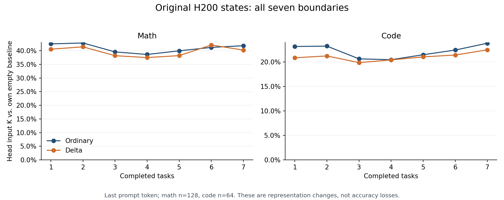
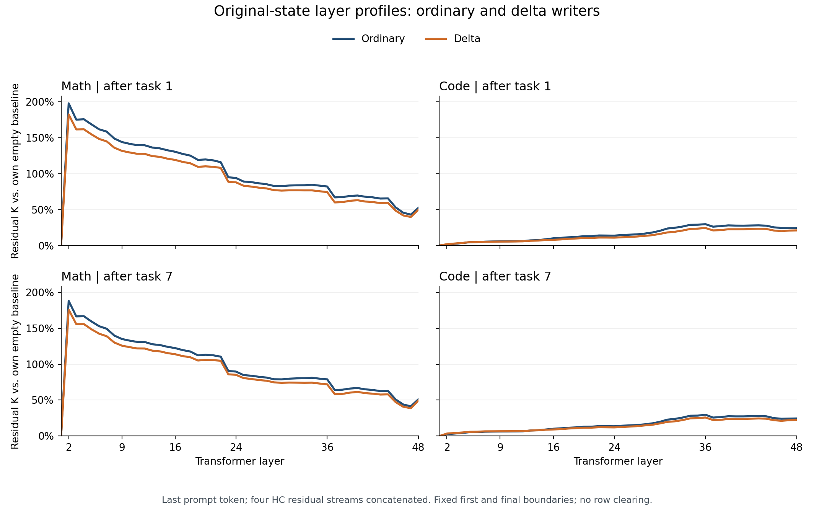
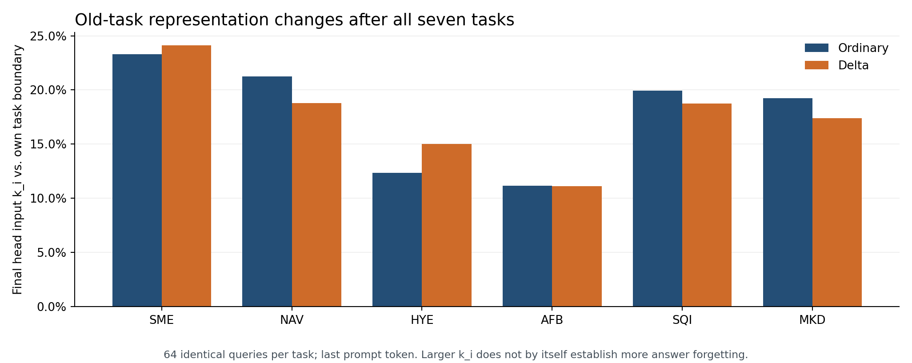
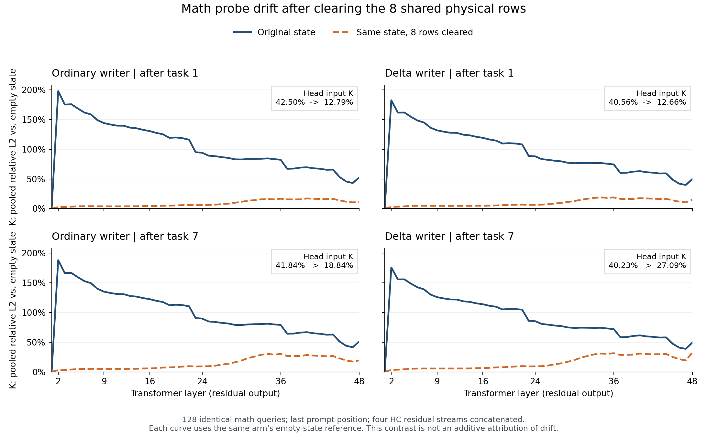
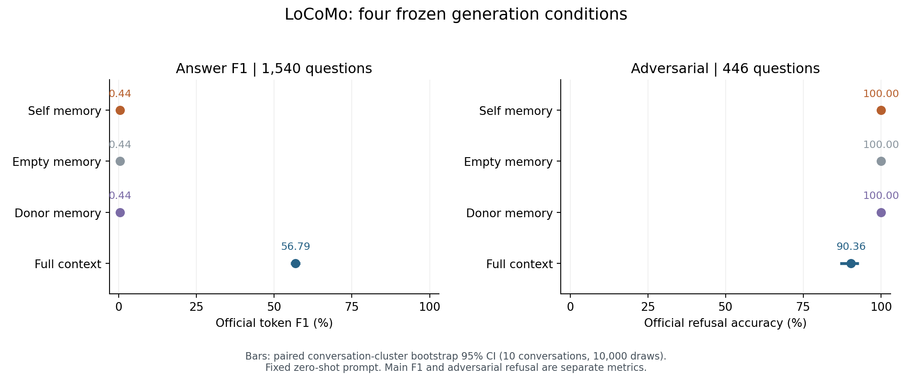
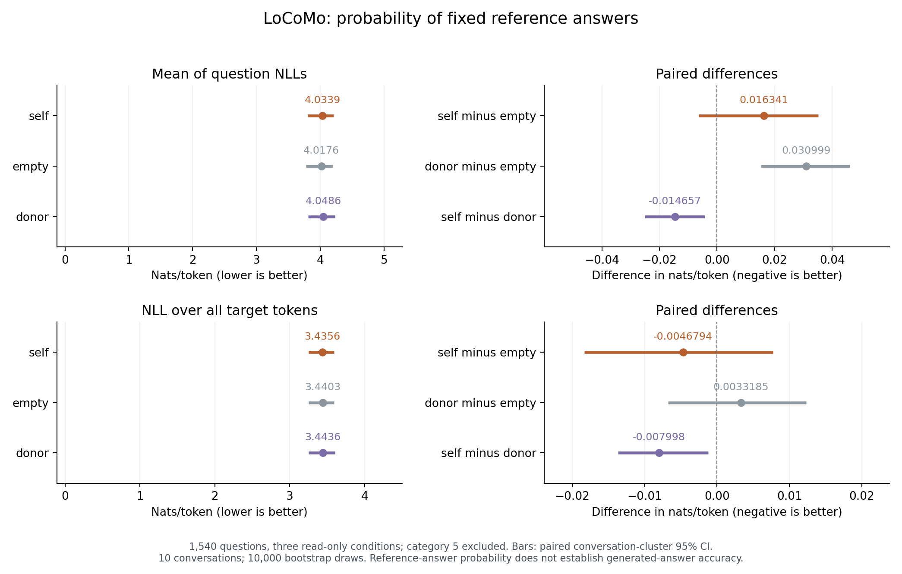

# Delta writer 的阶段判断：长链、共享行与 LoCoMo

**记录时间：2026-10-22；04:31 初稿，07:00 补齐七端点 K、小 kᵢ、八行清零及四幅图，11:16 补齐 LoCoMo 四条件生成，12:10 补齐参考答案 NLL、首 token／后续 token 分析与独立复算。均为北京时间。**

本文是对当前结果的独立复核。A800 和 H200 上两种 writer 的七任务写入链均已完成。H200 两种 writer 的完整七端点 NLL、4,200 个原始表示漂移单元及 700 个八行清零对照单元均已收齐。独立复核验证了全部交付文件 SHA、700 项原始 K 对应关系，以及 1,792 组清零前后问题的提示、参考答案和 token 身份；NLL 已从原始逐题记录重算。

## 1. 当前判断

**Delta writer 完成本次长链写入且未发生数值崩溃，但现有结果不支持把原始 head K 较小概括为较小表示漂移的优势。** 同题回忆、DEV64 文档区分、共享行干预与 LoCoMo 结果需要分别判断。

可以支持的判断有五项：

1. **带记忆编码可以稳定完成本次长链。** A800 上 35,000 次连续写入完成，最终生成准确率接近普通 writer，未出现数值崩溃。此次结果没有体现出担心的持续自我强化直至失控。
2. **原始状态的 head K 较小没有在八行清零对照中保持一致方向。** 未清零时，delta 的数学 head K 在 6/7 个端点较小、代码在 7/7 个端点较小；最终数学为普通 41.84%、delta 40.23%，代码为 23.83%、22.48%。但数学八行清零后，delta 在 4/7 个端点反而更大，最终为普通 **18.8441%**、delta **27.0950%**，delta 高 **8.2508 个百分点**。这些结果不能概括为 delta 的较小 head 漂移优势，也不能直接认定能力损失。
3. **DEV64 的文档区分指标更高，干扰后仍保留这一方向。** 但正确记忆条件的绝对 NLL 也变差，不能把较大的 self–donor 差距直接解释成更准确的事实记忆。
4. **八条共享二元行确实是数学浅层大幅漂移的重要来源，但清零损失了参考答案 NLL 收益。** 两种 writer 首、末端点的第 2 层 K 均下降超过 98%；全部 14 个 writer×端点条件的 NLL 均变差。因此，当前证据支持定位漂移来源，未支持把这些行直接判断为有害污染。
5. **LoCoMo 本次零样本迁移没有取得生成层面的记忆收益。** self、empty、donor 三组每题都输出固定拒答，主集答案 F1 均为 0.44/100；提供完整聊天记录时为 56.79/100。参考答案 NLL 的 self−empty 差在两种总体口径下区间均跨零；首 token 变差，后续 token 的小幅改善也出现在错配记忆中。这里的 F1 是答案匹配分数，不是答对题目的百分比，详见 §8。

当前没有得到的结论：七任务规则获取更好、所有表示漂移更小、两种 writer 等效，或共享行污染已经解决。

新增的最终状态同题回忆检查为：普通 writer **103/448，22.99%**，delta writer **112/448，25.00%**。Delta 多答对 9 题（+2.01 个百分点），探索性配对检验未校正 p=0.0490，见 §7；两者均未呈现高比例复现已写入原题的现象。因此，这项相对优势与记忆效果仍弱可以同时成立。

因此，本文分别报告各项对照的相对差异及其证据边界。不能只因为七任务总准确率差异不显著，就把两个 writer 的行为概括成完全一样；也不能把某个原始漂移指标较小概括成整体优势。

## 2. 七任务准确率：终点接近，总体净获取仍为负

### 2.1 第 7 个任务后的逐题配对

同样的 448 道测试题，按原始 trace 复算，评分沿用 strip + Unicode NFC 后与任一参考答案完全匹配。

| 配对结果 | 题数 |
|---|---:|
| 两者都对 | 120 |
| 只有普通 writer 对 | 5 |
| 只有 delta writer 对 | 9 |
| 两者都错 | 314 |
| 普通 writer 总正确数 | 125 / 448，27.90% |
| Delta writer 总正确数 | **129 / 448，28.79%** |

Delta 比普通 writer 多 4 题，即 **+0.89 个百分点**。双侧 McNemar 精确检验 **p = 0.423950**。

固定这七个任务，在每个任务内对 64 道题成对重采样，200,000 次 bootstrap、seed 20261022，得到差值的描述性 95% 区间 **[−0.67，+2.46] 个百分点**。该区间只反映这一次运行在现有任务内的题目抽样不确定性，不包含训练种子和新任务的不确定性。

结论是：**当前没有检出终点准确率优势。** 这不等于证明两者等效，也不能把已观察到的差值确定地归为噪声。每任务 64 题也不存在统一的“误差 ±4 题”；不确定性取决于正确率、配对结果和采用的区间。

另外，两者虽然只有 14 题的对错不同，但 **53 题的规范化答案不同**。正确性相近不代表输出或状态完全相同。

### 2.2 获取与保持

| 指标 | 普通 writer | Delta writer |
|---|---:|---:|
| 每任务自身写入后的净获取，七任务合计 | −12 / 448 | −7 / 448 |
| 获取中由错变对 / 由对变错 | 5 / 17 | 4 / 11 |
| 前六任务自身写完 → 第 7 轮净变化 | −1 / 384 | −2 / 384 |
| 后续保持中由错变对 / 由对变错 | 2 / 3 | 2 / 4 |

总获取为负，但不能写“每个任务都持平或下降”：普通 writer 的 SQI 是 24→27，delta 的 MKD 是 26→27。

各任务“写入前”使用的是不同的历史状态。七项前测相加都是 138/448，**这不是在同一空记忆状态上测得的全任务基线**。

净衰退小要与获取弱一起解释。现有数字支持“正确题总数的后续变化小”，不支持“因为完全没学到，所以一定没有遗忘”的因果断言。

## 3. H200：原始大 K 与八行清零对照，旧任务小 kᵢ 未全面改善

口径：提示最后一个 token；相对 L2/RMS 漂移；残差层拼接四条流。大 K 从各自空记忆基线比较，小 kᵢ 从各任务自身写完时比较。以下均为同任务端点比较，百分号表示相对漂移量，不是准确率损失。

### 3.1 未清零状态的七端点 head 大 K

| 已写完任务数 | 数学：普通 | 数学：delta | 代码：普通 | 代码：delta |
|---|---:|---:|---:|---:|
| 1 | 42.50% | **40.56%** | 23.16% | **20.86%** |
| 2 | 42.84% | **41.42%** | 23.24% | **21.23%** |
| 3 | 39.56% | **38.18%** | 20.64% | **19.87%** |
| 4 | 38.63% | **37.49%** | 20.46% | **20.41%** |
| 5 | 39.96% | **38.21%** | 21.48% | **21.04%** |
| 6 | **41.22%** | 42.11% | 22.44% | **21.42%** |
| 7 | 41.84% | **40.23%** | 23.83% | **22.48%** |

在未清零状态中，数学的 6/7 个端点、代码的 7/7 个端点，delta 的 head K 较小；数学第 6 端点方向相反。上述数值保留了共享行的影响，须结合 §4.1 的干预对照解释。

两探针等权平均：第 1 端点为 32.83%→30.71%，相对低约 6.45%；最终为 **32.84%→31.35%**，相对低约 4.52%。这是未清零状态的描述性差异，轨迹并非单调降低。

数学八行清零后，delta 的 head K 在第 **2、5、6、7** 端点更大，即 **4/7**；最终普通为 **18.8441%**、delta 为 **27.0950%**，差 **+8.2508 个百分点**。因此，原始 head K 较小不能单独作为 delta 较小 head 漂移的优势证据。

本轮没有同状态重复捕获的 **head K 噪声基线**，也未估计这些差值的不确定性。两题未改状态的 NLL 一致性检查没有捕获逐层表示，不能替代该基线；不能把已观察到的差异直接归为噪声，也不能仅由 K 较大认定能力损失。

### 3.2 第 4 端点的数学早期层差距更大

| 数学探针大 K | 普通 writer | Delta writer |
|---|---:|---:|
| 第 2 层残差 | 153.03% | **94.80%** |
| 第 9 层残差 | 108.83% | **69.44%** |
| 第 48 层残差 | 47.26% | **46.80%** |
| Head 输入 | 38.63% | **37.49%** |

在这个未清零端点，delta 的数学早期层 K 较小，差距到输出端明显缩小。代码第 2 层则为普通 2.11%、delta 2.60%；结合八行清零结果，这些数值不能外推为所有域、所有层的漂移优势。

Delta 的数学第 2 层大 K 从第 1 端点 182.30% 降到第 4 端点 94.80%。因此，“第一任务后完全固定、以后不再变化”也不符合目前完整轨迹。

最终普通／delta 的数学第 2 层分别为 **187.99%／175.73%**，第 9 层为 **134.98%／125.71%**，第 48 层为 **51.17%／49.25%**。Delta 第 4 端点的较小浅层漂移没有保持在那个幅度，最终又上升；不能把中间端点最明显的差距当作最终改善。下图固定展示首、末端点，两种探针都使用全部 48 层。

### 3.3 最终旧任务的小 kᵢ：均值接近，各任务方向不一致

第 7 个任务写完后，相对于各任务自身写完时的 head 输入小 kᵢ：

| 已学任务 | 普通 writer | Delta writer |
|---|---:|---:|
| SME | 23.28% | 24.11% |
| NAV | 21.27% | 18.77% |
| HYE | 12.37% | 15.01% |
| AFB | 11.17% | 11.14% |
| SQI | 19.94% | 18.73% |
| MKD | 19.23% | 17.40% |
| **六任务等权平均** | **17.88%** | **17.53%** |

Delta 最终在 4/6 个旧任务上较小，SME、HYE 较大；平均仅低约 0.35 个百分点。第 4 端点曾是 SME、NAV、HYE 三项都较大，三项均值为普通 15.22%、delta 20.23%；该中间结果不能代替最终六任务结果。

因此，**“较少偏离通用基线”和“较少改变已学任务表示”仍需分别判断**。最终的小 kᵢ 没有全面改善，也不能概括为全面恶化；其大小不自动等于答题遗忘多少，仍须结合准确率和 NLL。

### 3.4 完整七任务 NLL：终点略低，但自身写入收益仍弱

下表使用每题答案 token 平均 NLL，再对每任务的 64 题平均；越低越好。“自身写入变化”是该任务写完减去该任务写入前。第一任务共用空记忆前态，第 2–7 任务则分别使用两种 writer 各自写出的历史前态。

| 任务 | 普通：自身写入变化 | Delta：自身写入变化 | 普通：最终 NLL | Delta：最终 NLL |
|---|---:|---:|---:|---:|
| SME | +0.1145 | +0.1803 | 1.7564 | 1.7563 |
| NAV | +0.0035 | **−0.0592** | 2.9968 | 3.0028 |
| HYE | +0.0312 | +0.0219 | 0.3646 | 0.3477 |
| AFB | +0.1533 | +0.2558 | 1.7870 | 1.7829 |
| SQI | +0.1019 | +0.0913 | 1.5145 | 1.4024 |
| MKD | +0.0050 | +0.0314 | 0.9445 | 0.9451 |
| AMH | +0.0713 | +0.0444 | 0.5065 | 0.5016 |
| **七任务等权平均** | **+0.0687** | **+0.0809** | **1.4100** | **1.3913** |

Delta 最终七任务平均 NLL 低 0.0188，其中 SQI 的差异最明显；但其自身写入后的平均变化仍为正，且比普通 writer 更大。因此，**终点略低不等于当次任务获取更好**。普通 writer 七项自身变化均为正；delta 的 NAV 是唯一负值，不能写成“两种 writer 的所有任务 NLL 都变差”。这些比较是描述性结果，尚无逐题 NLL 差值的区间或显著性检验。

Delta 的 NAV 自身写入为 **3.0571→2.9979**；第 4 端点曾回到 3.0443，最终为 3.0028。因此，中途的收益消退不能当作最终保持结果。前六任务从各自写完到最终的 NLL 变化均值为：普通 **−0.0014**、delta **−0.0190**；这表示答案概率指标的平均变化，不能直接替代生成准确率或小 kᵢ。

通用探针的最终 NLL 也需要单列：

| 探针 | 空记忆 | 普通最终 | Delta 最终 |
|---|---:|---:|---:|
| 数学，128 题 | 0.9039 | 0.8459 | 0.8552 |
| 代码，64 题 | 0.2469 | 0.2461 | 0.2514 |

数学上两者最终 NLL 均低于空记忆，普通更低；代码上普通接近空记忆，delta 略高。**表示漂移较小并不保证 NLL 更好，较大 K 也不自动意味着能力损失。** 逐 token 加权 NLL 保存在数据文件中，未与上述逐题口径混合。

## 4. 高频共享行：已经核实的机制线索

原生哈希、tokenizer、全部 35,000 条支持样本及边界状态的 CPU 核对得到：

- 128 个数学探针的提示最后三 token 都是 `Solution`、`:`、`\n`，IDs 为 `[35621, 25, 198]`。字段名是 `Solution`，不是 `Answer`。
- 最后位置读取 16 条物理行。其中 8 条二元 `(':', '\n')` 行与支持样本的 `Input:\n` 共用。
- 每条支持样本在位置 28（从 0 开始）的换行，恰好对这 8 条行各产生一个写入事件；没有发现这些行的额外哈希碰撞命中。
- 普通 writer 第 1／第 7 端点，每条行的块计数分别是 **5,000／35,000**。
- 另外 8 条三元 `('Solution', ':', '\n')` 行未被写入，计数和 Δ 都为零。

| 状态 | 八条二元行各自的 ‖Δ‖ / ‖T⁰‖ 范围 |
|---|---:|
| 普通 writer，第 1 端点 | 4.48–10.75 倍 |
| 普通 writer，第 7 端点 | 4.41–10.03 倍 |
| Delta writer，第 1 端点 | 4.61–11.74 倍 |

普通 writer 的八条 Δ 拼接后，第 1→第 7 端点相对变化为 8.79%，方向余弦为 0.997322。可以说第一任务结束时扰动已很大、最终仍相近；**目前没有行级证据证明 β≈0.1，或只写几次就收敛**。第一任务包含 5,000 次写入，不能表述为第一次写入。

Delta 在第 1 端点这八条行上的 Δ 范数并不更小，但其数学表示大 K 略小。这说明不能仅凭补丁幅度解释表示漂移；更新方向、投影、门控、归一化和上下文传播仍可能起作用。以下清零副本对照进一步检验了这些共享行的作用。

### 4.1 八行清零：浅层漂移明显下降，但答案 NLL 变差

两种 writer 的全部七端点均已完成数学 128 题的清零前向。干预仅将独立状态副本中固定 8 条物理行的 Δ 置零，保留 T⁰、其他行和其余状态字段；同一组提示、参考答案和各自空状态基线保持不变。这是对整份状态的行级干预，会影响提示中所有读取这些物理行的位置，不能只归因于提示最后一个换行位置。

两种 writer 的全部七端点、50 个捕获位置共 700 个对照单元均已完成；下表固定展示首、末端点。每个清零对照中的原始 K 均与完整原始报告逐项一致。

| 状态 | 第 2 层 K：原始 → 清零 | 第 9 层 K：原始 → 清零 | Head K：原始 → 清零 |
|---|---:|---:|---:|
| 普通，第 1 端点 | 197.72% → **2.52%** | 143.92% → **3.90%** | 42.50% → **12.79%** |
| 普通，第 7 端点 | 187.99% → **2.93%** | 134.98% → **5.06%** | 41.84% → **18.84%** |
| Delta，第 1 端点 | 182.30% → **2.92%** | 131.65% → **4.61%** | 40.56% → **12.66%** |
| Delta，第 7 端点 | 175.73% → **3.33%** | 125.71% → **5.65%** | 40.23% → **27.09%** |

这些同状态干预结果支持：**这 8 条共享二元行是本组数学探针大幅浅层漂移的重要来源。** 首、末端点的第 2 层 K 相对下降约 98.1%–98.7%，但 head 仍有残余漂移。最终 head K 的相对下降为普通 **54.96%**、delta **32.64%**；清零后普通为 **18.8441%**、delta 为 **27.0950%**，delta 高 **8.2508 个百分点**，七端点中有 **4/7** 为此方向。这里的下降比例是完整状态下的干预效应，不是可相加的“污染贡献率”，也不证明其他行或传播过程没有作用。

同一次前向还保存了参考答案 NLL，14 个 writer×端点条件均已有完整结果；清零后 **14/14 条件的逐题平均 NLL 均变差**，增加 0.0255–0.0600。逐题平均 NLL 越低越好，固定展示首、末端点：

| 状态 | 原始 NLL | 清零后 NLL | 清零 − 原始 |
|---|---:|---:|---:|
| 普通，第 1 端点 | 0.8407 | 0.9007 | **+0.0600** |
| 普通，第 7 端点 | 0.8459 | 0.9024 | **+0.0564** |
| Delta，第 1 端点 | 0.8489 | 0.9016 | **+0.0527** |
| Delta，第 7 端点 | 0.8552 | 0.9014 | **+0.0462** |

两种 writer 的空状态数学 NLL 均为 **0.9039**。清零后接近空状态，原始状态则更低；因此，**定位到表示漂移来源的假说得到支持，但“这些共享行造成有害污染”的判断没有得到这项 NLL 证据支持。** 在当前状态和这批参考答案上，保留这些行的 Δ 同时带来较大的表示变化与较低的 NLL，不能仅因共享或 K 较大就把它们视为无用更新。

此处是 teacher-forced 参考答案 NLL，不是自由生成正确率；清零后的生成准确率没有测量。逐题答案 NLL、损失总和与 token 数均已保存，逐 token 加权 NLL 可由后两项精确复算；没有保存逐 token 损失向量。当前表是描述性对照，尚未计算 NLL 差值的区间或显著性。结果也提示：后续门控不能只以减小 K 为目标，须同时保住相关查询的记忆收益。

## 5. 如何与 DEV64 联系

已有正式 B1 2×2 分析支持：两个训练终点的写入行为发生了变化，但还没有证明这种变化就是“少写通用内容”。

- **+35%／+70%** 是固定 T⁰ 编码下，delta 权重相对普通权重的文档区分指标 Δ_donor 的描述性增幅。
- 正式 60 项多重比较校正后，该对比在 1／4／8／16 篇干扰时显著，**零干扰未显著**。不能写成各距离都显著。
- 零干扰下，该参数对比的 self NLL 从 1.7741 升到 1.7849，donor NLL 从 1.7975 升到 1.8164。两者都恶化，donor 恶化更多，才扩大 Δ_donor。

若比较实际两条使用路线 A（普通权重、T⁰ 编码）与 D（delta 权重、带记忆编码），零干扰时的 `L_empty − L_donor` 为 0.04338→0.01972，后者约为前者的 45%；16 篇干扰时约为 64%。

这个量表示**另一篇文章的记忆对当前续写的帮助**，不是写入的通用内容数量，也不是格式行的写入量。因此，“DEV64 的非特有帮助较少”与“七任务共享行污染较少”可以组成待检验假说，不能直接视为同一机制已经成立。

更准确的联系是：**delta 改变了写入策略，在 DEV64 上扩大了文档区分指标；七任务未清零状态的 head K 在多数端点较小，但这一方向没有在数学八行清零对照中保持一致。** 清零后 delta 在 4/7 个端点的 head K 更大，最终为普通 18.8441%、delta 27.0950%。两类实验尚不能建立共同机制，也不能支持“更少通用内容”或较小 head 漂移的概括。八行清零同时减小 K、提高数学 NLL，进一步说明“漂移更小”不能直接作为“写入更有选择性或更有益”的证据。

## 6. 改进建议：按行限幅与上下文读出门控

这部分作为后续设计建议。当前实验继续使用已锁定的方法和检查点。

### 6.1 现有 β 是写入门控

普通 writer 和 delta writer 都已有状态感知的 β，输入包括旧 Δ、写入目标与旧值的差、计数等。D1 对同一样本内命中同一行的事件先求平均，再更新一次；跨样本仍会重复更新。计数进入门控特征，但没有强制按计数降低写入强度。

所以不能把建议描述为“目前没有门控，补一个就好”。

### 6.2 建议增加查询上下文感知的读出门控

原生 PLE 已有根据查询表征与读取向量计算的 HC 门控。这里建议的是**新增 Δ 专属的适用性门控**，不是声称原模型没有读出门控；现有 HC 门控与基表路径保持冻结。

二元 `(':', '\n')` 无法区分七任务的 `Input:\n` 与数学探针的 `Solution:\n`。可以让当前查询上下文决定某条补丁是否适用，例如：

\[
T_j^{\mathrm{read}}(x)=T_j^0+g(x,j)\,\Delta_j,\qquad 0\leq g(x,j)\leq1.
\]

其中 `x` 是当前读取位置可用的因果上下文。目标是在相关上下文保留已写入信息，在不相关上下文降低共享行补丁的影响。门控只作用于 Δ，保留基表 T⁰；具体计算位置和训练目标需要另行验证。

也可以研究写入端的结构位置门控，让高频模板行的更新更谨慎。不过语言、特征和字段行可能承载规则迁移所需的信息，不能先验地把所有共享行都当作无用格式删除。

### 6.3 用清零诊断确定门控应解决什么

当前按“模板／固定指令／字段名位置读取的行”得到 151,623 条共享行，但其中只有 720 条来自完全结构化的 n-gram，150,903 条包含跨内容边界的上下文。这个广义集合的清零效果不能解释成纯格式的因果份额。

因此，**主机制检验只清零已定位的 8 条二元行的 Δ，保留其 T⁰ 和所有其他行**，在相同状态、相同数学提示上比较第 2 层到 head 的大 K。已取得的结果见 §4.1：浅层 K 大幅下降，但参考答案 NLL 变差。该干预支持这些行是重要的表示扰动来源，不证明它们是唯一原因，不提供可加性的归因分解，也不支持把直接清零作为已有性能改进。

广义共享行清零曾列为辅助诊断，**本轮按收窄后的算力安排未执行，不能列入已完成结果**。若后续单独开展，也不能把它解释成纯格式行的作用；同样应只操作独立状态副本，不作为新训练方法。

### 6.4 按行限制补丁相对基表的范数

论文中可以单独报告：**在已核对的高频共享二元行上，Δ 的范数约为对应 T⁰ 行范数的 4–11 倍量级；现有机制未显式约束这一相对幅度。** 精确范围见 §4，delta 第 1 端点的上界为 11.74 倍。

这不等于“没有任何幅度控制”或“状态已经发散”：β 已控制每次更新的强度，较大的 Δ/T⁰ 也可能部分源于基表行范数较小。是否有害，需要结合清零后的表示和输出变化判断。范数比也不表示最终 `T⁰ + Δ` 的每个元素都放大同样的倍数。

一个简单的后续方案，是对每行施加显式上限：

\[
\Delta_j \leftarrow \Delta_j\min\!\left(1,\frac{c\,\lVert T_j^0\rVert}{\lVert\Delta_j\rVert+\varepsilon}\right).
\]

即超限时保持补丁方向、等比例缩小长度，令其不超过基表行范数的预设倍数。`c`、接近零的基表行如何处理，以及是否损害有效记忆，都需要另行验证，当前没有选择阈值或执行限幅。

限幅约束“补丁能有多大”；上下文读出门控控制“当前场景用多少”。两者可以互补，**均只列入展望，第二篇不新增实现或训练变体**。

### 6.5 如果另立读出门控训练实验

以下是对后续实验的设计建议，**尚未实现、登记训练预算或启动训练**。建议先回答“已有记忆能否读得更好”，再研究 writer 与门控的联合适应。

**第一阶段：固定写出的状态，只训练门控。** 固定一个 writer 检查点、主干、T⁰、原生 PLE 投影与 HC 门控。训练证据依旧按原方法写入；新增门控只用于查询，不能在这一步反过来改变支持样本的编码和 Δ。对每条读取行使用共享小网络产生一个标量：

\[
g_{t,j}=\sigma\!\left(f_\theta(h_t^{\mathrm{pre}},\operatorname{norm}(\Delta_j),e_{\mathrm{head}(j)},s_j)\right),
\qquad E_{t,j}=T_j^0+g_{t,j}\Delta_j.
\]

`h_pre` 取 PLE 注入前的因果表征；`s_j` 可包含计数和补丁范数等既有状态统计，是否使用由消融决定。网络跨物理行共享，不给每个行号设置独立可训练参数。当前 PLE 在第 2 层注入，该上下文只经过第 1 层，不能把它描述成最终层语义。使用更深表征会涉及额外前向或不同结构，应另列方案；不能把依赖当前读出结果的表征循环送回同一次读出。

门控放在 Δ 加到 T⁰ 之前，只缩放 Δ，所有读出位置都执行。强制 `g=1` 应复现原路径；强制 `g=0` 应复现空记忆路径。若初始输出只是接近 1，必须记录初始差异，不能声称初始化完全等价。冻结主干参数仍需保留损失传到门控的计算图；不能把门控之后的整个读取前向置于 `no_grad()`。因此，参数量小并不表示训练只需要小网络的算力。

**训练单元：先写证据，再回答独立查询。** 在新的训练文档、对话和可控键值/问答数据上构造：相关记忆、非空但无关的记忆、相同模板下容易混淆的记忆，以及加入不同数量干扰后的相关记忆。长距离信息是否存在于记忆中，需要由数据构造保证。只提供空记忆的负例对门控没有有效训练信号，因为 Δ 已为零。相关/无关标签用于组织训练和统计，不能作为门控输入；查询答案不参与写入，预测位置也不能读取未来 token。

先用查询目标的交叉熵训练。若需要保护无关场景，可只在已确认与查询无关的记忆条件下，增加相对冻结空记忆模型的 KL 约束；权重用新的开发集确定。不能对所有相关查询强制接近空记忆输出，也不以最小化 K 作为主损失。相关任务应包含需要新写事实才能回答的例子，否则全关门控可能成为轻易的解。

**最小对照矩阵：** 对同一 writer 写出的同一份状态、同一组查询比较：

| 条件 | 用途 |
|---|---|
| `g=0`，空记忆读出 | 识别关闭记忆的退化解 |
| `g=1`，原始方法 | 当前方法基线 |
| 开发集选定的统一标量 `g=c` | 检验收益是否只是整体缩小 Δ |
| 不输入查询上下文的状态门控 | 区分按行计数/幅度校准与上下文选择 |
| 完整上下文门控 | 待验证方法 |

消融应尽量保持网络结构和训练预算一致，例如把上下文分支替换为固定输入。固定八行清零作为机制诊断，不作为“已经学会选择”的证据。第一轮不同时加入范数上限，以免把两种改动的收益混在一起。可以先以 delta writer 为主实验，再按同等预算验证普通 writer；若要比较两种 writer 在门控下的优劣，必须明确门控是各自训练还是跨 writer 迁移，不能混用两种口径。

**联合判据：记忆有效性和干扰都要测。** 主指标至少同时报告相关查询的绝对 NLL/准确率、`L_empty−L_self`、`L_donor−L_self`，以及无关查询相对空记忆的性能损失。再报告长链保持、大 K、小 kᵢ、门控接近零的比例和各类位置的分布。只有 K 降低而记忆收益消失，应解释为抑制记忆；如果只优于 `g=1` 而不优于统一缩放，应解释为幅度校准，尚未证明上下文选择有效。成功标准是在预先约定的记忆收益下减少无关损失，或在相近无关损失下提高记忆收益。

另设“保持 Δ 不变、改变查询语境”和“保持查询不变、更换相关/无关 Δ”的配对检查。相同模板、不同查询，以及不同模板、相同事实的组合，可以检验是否只学会关掉标点和模板行。每个训练种子内按文档/对话成组配对统计，再独立报告训练种子间变化；建议完整方案至少三个训练种子。当前 DEV64、七任务及已用于分析的数据用于历史回归，新方法的模型选择和最终证明需使用独立划分。原封存 FINAL 的登记仍只对应原锁定检查点，不能转作新门控的调参集。

**第二阶段：必要时联合训练 writer 和门控。** 只有第一阶段结果明确后，再加同等训练数据和预算的“writer 继续训练但无新增门控”对照，检验联合训练的增益。是否在支持编码时也启用门控必须作为独立因素登记，因为这会改变后续写出的状态。若多个答案已在同一行被不可逆地混合，标量门控只能选择压低或保留该向量，无法凭空恢复每个答案；此时更可能需要改进写入绑定或寻址，而不是继续增大门控。

## 7. 已见题回忆：两种 writer 的最终状态同题比较

**分别使用 A800 上普通 writer 和 delta writer 的最终 Δ。** 每个任务从已写入的支持样本中固定抽 64 条，共 448 条；两种 writer 使用完全相同的抽样清单、提示 token 和评分规则。提供原提示进行真实贪心生成，标准答案仅交给评分器。

- 只使用最终状态，不重跑写入链，不进行写入优化。
- 沿用原始 Swift 提示、关闭思考、最多 128 个新增 token 和原评分规则。
- 抽样按固定样本身份的哈希顺序锁定，先保存清单和 SHA，再执行。
- 结果与未见题泛化准确率分开，报告各任务及总分。

### 7.1 结果

| 任务 | 普通 writer 正确 / 题数 | Delta writer 正确 / 题数 | Delta − 普通 |
|---|---:|---:|---:|
| SME | 7 / 64 | 11 / 64 | +4 |
| NAV | 2 / 64 | 2 / 64 | 0 |
| HYE | 25 / 64 | 28 / 64 | +3 |
| AFB | 1 / 64 | 3 / 64 | +2 |
| SQI | 22 / 64 | 22 / 64 | 0 |
| MKD | 28 / 64 | 27 / 64 | −1 |
| AMH | 18 / 64 | 19 / 64 | +1 |
| **总计** | **103 / 448，22.99%** | **112 / 448，25.00%** | **+9，+2.01 个百分点** |

两种 writer 各 448 条输出均满足原评分器的格式检查，**均没有截断**；普通共生成 2,651 个 token，delta 共生成 2,678 个 token。格式有效只表示输出形态合规，不表示答案正确。评分对原训练样本的目标词形做 strip + Unicode NFC 后精确匹配，没有按结果补充参考答案或放宽规则。

这些题都来自实际写入过的 35,000 条支持样本，448 个提示互不重复，与原 448 道泛化题的提示重叠为零。抽样清单 SHA-256 为 `b32e9d38e428b7edacad4d577410e79ea76359199762c03c07cc156a2ef30e7c`。

### 7.2 状态与生成核验

- 每次只恢复相应 writer 的最终状态；delta 的七字段 hash 为 `323f278df9da966eea6166fd81ebeb7de78d4ebce8daa7b83781534563d832de`，普通为 `68c8ee78ec2e3c1435f130498493da70f176aca144d41368621d3389496b6db6`，两者 block clock 均为 35,000。
- 八个 TP 副本状态一致，生成前后七字段 hash 一致，原正式检查点文件 SHA 一致。
- 独立只读 worker 没有加载 writer；D1 更新、反向传播、优化器步骤均为零。
- 两种 writer 均先完成缓存历史、地址、重复请求和物理 slot 复用检查，再执行 448 题；两个进程均正常退出。Delta 包括模型加载与检查在内总耗时约 416 秒。
- 普通 writer 补测前后，已完成 delta 运行的 70 个文件 SHA 全部不变。另用未导入原评分器的脚本，直接读取两组原始 trace，独立复算了正确数、逐题配对及 McNemar 精确概率。

### 7.3 配对统计与结论边界

| 同一题上的结果 | 题数 |
|---|---:|
| 两者都对 | 99 |
| 只有普通 writer 对 | 4 |
| 只有 delta writer 对 | 13 |
| 两者都错 | 332 |

Delta − 普通为 **+2.008929 个百分点**。双侧 McNemar 精确检验 **p=0.049041748046875**。每任务内成对重采样、七任务保持各 64 题，200,000 次 bootstrap、seed 20261022，差值的描述性 95% 区间为 **[+0.22，+3.79] 个百分点**，对应净多答对 [+1，+17] 题。共有 68 题的规范化答案不同，token 序列也有 68 题不同。

这是补充性的探索分析，p 值未对整个研究中的多项比较作校正，且接近 0.05。区间仅覆盖本次固定七任务内的题目抽样不确定性，不包含训练种子、写入链或新任务的变化。因此，适合表述为 **“delta 在本次已见题回忆中略优，存在有限的配对证据”**，不宜扩写成稳定、普遍的记忆优势。这与 §2 未见题比较的 p=0.423950 是两项不同结果，不能混用。

这项检查回答“最终状态能否答出已经写过的原题”。**两者最终状态均没有表现出高比例的原题复现；现有结果不支持‘已见题记得很好，只是泛化失败’这一解释。**

普通／delta 的未见题终点分别是 125/448、129/448，已见题分别是 103/448、112/448。已见与未见是两组不同题目，不能作为逐题配对的记忆收益，也不能直接据此断言记忆使表现下降，因为题目难度和参考答案集合不同。

此次两种 writer 补测都没有同题空记忆、写入前或自身任务刚写完时的生成对照。因此，正确率本身不能证明正确答案来自新增记忆，错误率也不能区分从未获取与后来遗忘。两者同题 NLL 尚待补算；按最新算力安排，后续迁到 A800。

**结果状态：两种 writer 的生成、评分、配对统计及独立复算均已完成，原始逐题输出与评分已保存；同题 NLL 待补。**

### 7.4 地址共享是具体线索，但不能断言长距离映射在结构上不可能

CPU 核对发现，448 道题在首次预测答案时，提示最后两个 token 均为 `[248069, 271]`（`</think>\n\n`），最后三个均为 `[271, 248069, 271]`。实际生成检查中，两条不同提示末端读取同一组 16 条物理行；其余题具有完全相同的局部键。**这里的 16 行是对话答案入口，区别于 §4 数学探针 `Solution:\n` 中的 8 条共享二元行。**

这支持一个具体假说：许多不同样本的更新写到共用入口，可能混合或覆盖本应按“词元＋特征”区分的答案信息。但 D1 是带门控的顺序更新，不能描述成把 5,000 个答案直接做一次算术平均。

实际 writer 的每行特征包括当前位置的上下文表征、右侧 4 个有效 token 的表征均值、整块的注意力池化和 head 特征。单个主干表征是因果的，但支持样本连同答案已经完整到达 writer，右侧窗口与池化可能把答案信息提供给更早的行。因此，**不能说 writer 看不到答案，也不能把它等同于只预测局部 n-gram 后一个 token 的独立查表器**。多个行还共享 writer 参数与块级表征。

查询主干也会通过注意力利用前面词元、特征位置读取的补丁，所以“末端键共有”不代表整个预测只能使用共有行。更准确的解释是：当前冻结写入策略可能没有学会把词形答案绑定到查询时可区分且可利用的地址上，而不是已证明这类结构绝不可能表示长距离映射。

第一篇的关键差别是对当前词形任务使用答案损失优化表行：梯度沿主干计算图调整参与预测的行。当前 writer 离线也经过联合训练，但七任务在线写入时参数固定，没有针对这些题的答案损失纠错。DEV64 原文续写更接近其训练分布，局部实体、短语重现可能更适合这类寻址；这仍不证明新闻事实必然局部相邻，或 DEV64 收益已经归因于这一机制。

## 8. LoCoMo：三组短提示均固定拒答，未观察到记忆收益

### 8.1 固定方法与完整结果

这里检查的是离线训练好的 delta writer 能否直接迁移到长对话回忆。使用与七任务评估相同的冻结检查点；每段对话独立从空记忆开始，没有加载七任务末态，也没有针对 LoCoMo 重新训练或调提示。证据按每帧 512 个新 token、最多 128 个旧前缀 token 写入，先裁剪再计算 writer 特征，每帧执行一次 D1，α=1。10 段对话合计 426 次写入；回答问题时状态只读。

全部四条件在 A800 运行：self 读取本对话状态，empty 读取空状态，donor 读取其他对话状态，full-context 直接读取完整原始聊天记录且关闭 Δ。三组短提示使用 FP32 split PLE 读取路径，全文条件使用 BF16 原生 prefetch offload 路径；全文提示不截断，图像只使用数据中附带的文字描述。四组均保留预先固定的指令，其中明确要求无相关信息时回答 **“No information available”**。

四组共 **7,944 条**生成已封存，随后才运行原评分器。原 717 条短提示试运行和 239 条全文试运行结果逐字节保留，未因结果修改方法或重新生成。三组短提示的 30 组状态检查、全文的 8 rank 权重检查均通过；问答阶段没有写入、反向传播或优化器更新。

### 8.2 答案匹配结果

主集为类别 1–4 的 **1,540 题**，使用原评分器的类别感知 token F1。区间按 10 段对话成组重采样 10,000 次，seed=20261022；独立复算验证了全部 42 组条件及配对差区间。

| 条件 | 主集 F1（0–100） | 95% 会话聚类 bootstrap 区间 |
|---|---:|---:|
| Self memory | 0.4391 | [0.2160, 0.6793] |
| Empty memory | 0.4391 | [0.2160, 0.6793] |
| Donor memory | 0.4391 | [0.2160, 0.6793] |
| Full context | 56.7936 | [55.3313, 58.3414] |

Self−empty 和 self−donor 的逐题分数差均为零；self−full-context 为 **−56.3545 分**，95% 区间 **[−57.9064, −54.8072]**。分项如下，三个短提示条件分别得到相同结果：

| 类别 | 题数 | 每个短提示条件 F1 | Full-context F1 |
|---|---:|---:|---:|
| 多跳 | 282 | 0.7092 | 53.3632 |
| 时间 | 321 | 0.1558 | 29.2959 |
| 开放域 | 96 | 3.5023 | 20.4663 |
| 单跳 | 841 | 0.1070 | 72.5862 |

三组短提示各自的 1,986 题全部输出同一个 token 序列，解码为 **“No information available”**。因此，微小的非零 F1 不能作为有效读取对话记忆的证据。全文条件有 1,142 种输出 token 序列，其中同一固定拒答序列出现 589 次；1,953 题以结束符停止，33 题以长度上限停止。另有 38 题恰好生成到最大 token 数，这一计数与“因长度停止”不同。

类别 5 的 **446 道诱饵题单独报告**：三个短提示条件的拒答准确率均为 **100%**，全文为 **90.3587%**，95% 区间 **[86.8360%, 92.8421%]**。三组短提示无差别拒答就能取得这一高分，不能据此认为其记忆能力更好，也不将此指标与主集 F1 合并。

### 8.3 首个答案 token 的入口没有直接读取 Δ

直观地说，给模型看完整记录时，它能回答不少问题；只让它使用本次写入的记忆时，它每题都拒答，表现与空记忆和错配记忆相同。**本次冻结检查点、固定提示及读取实现下，没有观察到可用的生成回忆收益。**

沿用 §7.4 的原生寻址核对方法，CPU 审计重新编码了全部 1,986 个固定提示，并加载了实际十份对话状态。首个答案 token 的预测来自提示最后位置；该位置末两 token 为 `</think>\n\n`，IDs 为 `[248069, 271]`，末三 token 为 `[271, 248069, 271]`。全部问题读取相同的 16 条物理行，与七任务对话模板的答案入口地址相同。

**十份实际状态中的这 16 条行全部未写入，直接读取的 Δ 和计数均为零。** 审计覆盖 16×10=160 个状态行组合；实际查表返回 25,600 个 FP32 零值和 160 个零计数。全部 426 帧、215,278 个新 token 的 3,444,448 次地址事件中，没有碰撞命中这些入口行。完整状态的行集合、D1 计数和最后写入时刻均与证据重算一致，状态文件和七字段检查前后不变；这项检查没有运行模型前向。

这将解释范围收窄为：**答案入口没有可直接读取的记忆补丁；若记忆要影响首个答案 token，须先在前面的提示位置被读取，再经注意力、因果卷积等传播到答案位置。** 当前 writer 来自原文续写训练，没有针对 LoCoMo 的“问题读取记忆→答案入口”路径训练；因此，原文续写上的收益不保证迁移为对话问答收益。这与 §7.4 的寻址与训练目标讨论相接，但还不能由入口为零单独证明整个失败的因果过程，也不表示此前位置的 Δ 对首 token 概率必然无影响。

相同贪心输出不等于完整答案概率分布相同。首 token 与后续 token 的分别汇总已在正式 NLL 结果产生前登记，实际结果见下节。后续 token 在正确答案前缀条件下评分，其改善也不能替代自由生成回忆。

### 8.4 参考答案 NLL：整体未显示 self 相对空记忆的稳定改善

1,540 道类别 1–4 问题的 self、empty、donor 共 **4,620 次**只读前向于 12:06 完成，实际进程正常退出，8 卡释放。每条件包含相同的 **10,804 个目标 token**；30 组状态检查、9,240 条请求事件及逐题原子记录与合并结果均通过核对。D1、反向传播、优化器步骤和查询时记忆更新均为零。独立脚本由原始逐 token log-probability 复算 NLL 和全部 12 组总体区间。

每题在原提示后拼接固定参考答案，单次主干前向后以完整词表归一化计算答案损失；不增加 EOS 损失。类别 1 保留完整多项答案，类别 3 沿用原评分器的分号首段；446 道类别 5 诱饵题不进入主 NLL。目标长度为 1–68，提示加目标最长 125 token，无截断、无超长遗漏，也未根据概率选择参考答案。

以下 NLL 单位均为 nats/token，越低越好。“逐题平均”先对每题答案 token 平均再平均所有题；“全 token 加权”直接将损失总和除以全部目标 token 数，两者不能混用。

| 条件 | 逐题平均 NLL | 全 token 加权 NLL |
|---|---:|---:|
| Self | 4.03392 | 3.43564 |
| Empty | 4.01758 | 3.44032 |
| Donor | 4.04857 | 3.44364 |

| 配对差 | 逐题平均差 [95% 区间] | 全 token 加权差 [95% 区间] |
|---|---:|---:|
| Self − empty | +0.01634 [−0.00634, +0.03519] | −0.00468 [−0.01835, +0.00771] |
| Donor − empty | +0.03100 [+0.01527, +0.04614] | +0.00332 [−0.00675, +0.01233] |
| Self − donor | −0.01466 [−0.02504, −0.00427] | −0.00800 [−0.01370, −0.00120] |

区间沿用 10 段对话成组配对重采样，10,000 次，seed 20261022。**Self 相对 empty 的两种总体区间均跨零，点估计方向也因加权口径不同而改变，未显示整体参考答案概率的稳定改善。** Self 相对 donor 的 NLL 较低、两个描述性区间均未跨零，说明固定计算路径中存在与状态来源有关的差异；但这一差异没有转化为相对空记忆的明确总体收益或实际生成收益。

**方法修订与解释范围。** 正式运行前的跨形状数值检查中，14 项比较有 9 项超过原 0.005 nats 阈值，最大绝对差为 0.344737；原检查失败和 exit 1 记录均保留。检查后、正式运行前，根据用户明确指示登记修订，直接按原定单次完整 prefill 方法完成全部 4,620 次计算，未修改目标、状态或损失算法，也未另跑 GPU 门禁。CPU 复核未发现目标移位、词表分母或 log-probability 解析错误；这些检查不构成与逐前缀生成路径数值等价的证明。上述区间仅表示这十段对话的抽样不确定性，未覆盖计算路径变化，也未作多重比较校正。原 14 项最大差既不是所有正式结果的误差上界，也不是噪声基线；不能据它把观察到的条件差异直接判为噪声。

### 8.5 首 token 变差，正确前缀后的改善并非 self 独有

首 token 覆盖全部 1,540 题，逐题与逐 token 两种平均完全相同。后续部分覆盖 1,436 题、9,264 token，排除 104 道单 token 答案，不填零；同一组会话重采样同时用于全部条件、位置分组和口径。

| 位置与口径 | Self NLL | Empty NLL | Donor NLL |
|---|---:|---:|---:|
| 首 token | 9.23916 | 9.10985 | 9.27507 |
| 后续 token，逐题平均 | 2.23395 | 2.25424 | 2.23863 |
| 后续 token，全 token 加权 | 2.47089 | 2.49785 | 2.47425 |

| 位置与口径 | Self − empty [95% 区间] | Donor − empty [95% 区间] | Self − donor [95% 区间] |
|---|---:|---:|---:|
| 首 token | +0.12931 [+0.06010, +0.18958] | +0.16521 [+0.12734, +0.20025] | −0.03590 [−0.07299, +0.00070] |
| 后续 token，逐题平均 | −0.02029 [−0.03134, −0.00796] | −0.01561 [−0.02623, −0.00595] | −0.00468 [−0.01257, +0.00391] |
| 后续 token，全 token 加权 | −0.02695 [−0.03618, −0.01707] | −0.02359 [−0.03032, −0.01714] | −0.00336 [−0.00881, +0.00266] |

**首 token 上，self 和 donor 都比 empty 更差；给定正确答案前缀后，两者都略有改善。** 后续部分的 self−donor 区间在两种口径下均跨零，首 token 的 self−donor 区间也跨零。这些分项结果不能称为已检出对本对话的特异性回忆，也不能由“续写更顺”推导“能够自行开始正确回答”。分项区间跨零和总体 self−donor 区间未跨零并不矛盾：聚合涉及不同权重及各部分的协方差。

结合 §8.3 的直接入口 Δ 为零，可以确认入口未写入不意味着条件概率完全不变；状态仍可能通过前面的提示位置影响首 token。当前损失结果没有定位具体信息来源或建立失败原因的因果链。后续部分既有正确答案前缀，又可能读取不同局部地址；self 与 donor 的共同改善尤其不能直接归因于读回了本对话的正确事实。**本次补测仍不支持“记忆已经有效存取，只是贪心生成未显示出来”的结论。**

## 9. 收尾与报告边界

1. H200 两种 writer 的完整七端点 NLL、大 K、小 kᵢ、逐层剖面及八行清零的 700 单元矩阵均已完成；独立文件与数值核验通过，四幅图已补入 §3–4。
2. 两种 writer 的最终已见题回忆生成与配对分析已完成，两者同题 NLL 待补。
3. 两台机器的 16 对端点状态已完成 CPU 核对和 H200→A800 副本保全；45 组原始捕获共 43,341,886,306 字节已在 A800 验证保存，最终 313 个小结果文件已本地逐文件核验。06:56 已确认 H200 所有本任务 GPU／评分进程退出、4 卡显存为零，可由用户手动关机。B2 完成状态另以云端校验回执记录。
4. LoCoMo 三组短提示的 5,958 条生成于 07:33 完成，全文 1,986 条于 11:04 完成；四条件全部封存后，CPU 评分正常退出。原始生成、状态、完成与退出记录、实际运行源码和评分文件均已按 SHA 取回，主集 F1、诱饵题拒答及独立复算结果见 §8。
5. H200 已完成当前原链和八行清零诊断，并已告知用户可手动关机；本报告不将这一就绪状态写成已确认关机。其余后续补测迁到 A800。原先包含同题 NLL、同状态对齐、广义共享行和 LoCoMo 的 H200 等待队列已取消，八行清零由独立窄队列完成。不由本报告新增训练变体。
6. FINAL 的锁定 ordinary 检查点和 training08 运行记录已在 A800 保全，但原 EP4 执行方式不能直接迁移：仅专家权重就需要每卡 56.25 GiB，超过 A800 每卡 39.67 GiB，且现有原生软件栈版本不同。FINAL 尚未运行；使用八卡新拓扑或 CPU 卸载需另行验证运行路径，不能把 CPU 准备完成写成 FINAL 测试完成。
7. LoCoMo 只读参考答案 NLL 已于 **12:06 完成全部 4,620 次前向并正常退出**，包括加载在内耗时约 17 分 03 秒。保留原提示、原生成结果和原十份状态，在四条件生成完整封存后才读取参考答案。原跨形状检查失败如实保留，正式计算按明确登记的修订执行；完成后的 CPU 文件、逐 token 损失、只读状态和统计复核均通过。总体 NLL、首 token／后续 token 及解释范围见 §8.4–8.5；较低参考答案 NLL 不能替代自由生成正确率。

A800 准确率和 H200 NLL／漂移来自两条独立状态轨迹，仍须分别标明。完整 16 对状态（两种 writer，各含空态和七个端点）已逐字段核对：物理行号、计数、块时钟及三项衰减／写入时间元数据完全一致；非空状态的 `values` 存在差异。按完整物理行并集以 FP64 计算：

| 已写完任务数 | 普通 `‖Δ_A800−Δ_H200‖/‖Δ_H200‖` | Delta 同口径 |
|---|---:|---:|
| 1 | 6.2945% | 4.6330% |
| 2 | 5.6018% | 4.1454% |
| 3 | 5.6286% | 4.1746% |
| 4 | 6.0256% | 4.3167% |
| 5 | 6.2105% | 4.3508% |
| 6 | 6.3772% | 4.2792% |
| 7 | **6.2950%** | **4.2095%** |

两种 writer 的空态均完全一致、Δ 为零，故不报告以空态 Δ 范数为分母的比值。上述数字是**两套执行路径最终写出的状态值之差**，不是表示大 K、准确率差或统计误差范围；也不能据此将两条轨迹视为同一状态。全部 H200 原始端点副本已在 A800 完成 SHA 回读验证。

原先在 H200 上读取 A800 状态补齐 NLL／漂移的队列已取消；同状态指标补测改到 A800，须先验证相应读取和表示捕获路径，当前尚未取得这组完整指标。

只有一次训练与一次正式七任务链，七任务还属于已用于研究动机的历史任务复验。较小漂移不是较高能力的充分条件，统计未显著也不是等效证明。

**目前适合写进论文的概括：**

> 带记忆编码的 delta writer 在本次长链前向写入中保持数值稳定。其七任务未见题终点准确率与普通 writer 接近，总体规则获取仍弱；最终状态对同一批 448 道已写入原题的准确率为普通 22.99%、delta 25.00%。Delta 在该补充回忆检查中略优，但两者均未呈现高比例的原题复现。未清零状态的 head K 在多数端点较小，不能据此概括为较小 head 漂移优势：数学八行清零后 delta 在 4/7 个端点更大，最终普通为 18.8441%、delta 为 27.0950%，差 +8.2508 个百分点。现有数据没有重复 head K 噪声基线，不能将这一差异认定为噪声或能力损失。固定八行清零使数学浅层 K 大幅下降，却使全部十四个条件的参考答案 NLL 变差，表明表示变化不能直接等同于有害污染。
>
> LoCoMo 三组短提示的 5,958 条生成全部是同一固定拒答；self、empty、donor 之间没有一道题的贪心输出改变，主集 F1 均为 0.4391/100。提供完整聊天记录时，主集 F1 为 56.7936/100。补充的单次 prefill 参考答案 NLL 中，self 相对 empty 的总体差在两种加权口径下区间均跨零；首 token 变差，正确前缀后的微小改善也出现在 donor 中。Self 相对 donor 的总体 NLL 较低，但不能据此认定对话事实已被有效回忆。故本次冻结检查点与固定提示下未观察到生成层面的对话记忆收益，NLL 补测也没有提供相对空记忆的明确总体收益。这些 NLL 结果只适用于本次固定的单次 prefill 计算路径；跨形状等价检查未通过，抽样区间未覆盖计算路径不确定性，失效原因仍未确定。

## 数据与复算入口

- [A800 两链完整计分与逐题变化](../artifacts/qwen38_a800_forward_20261021/live_v3_score_audit_20261021T201845Z/closeout_report.json)
- [McNemar 与分层配对 bootstrap](../artifacts/qwen38_a800_forward_20261021/live_v3_score_audit_20261021T201845Z/paired_uncertainty_report.json)
- [最终 delta 已见题回忆：完整评分与状态审计](../artifacts/qwen38_a800_forward_20261021/final_delta_recall_20261022_v2/recall_report.json)
- [最终普通 writer 同题回忆：完整评分与状态审计](../artifacts/qwen38_a800_forward_20261021/final_ordinary_recall_20261022_v1/recall_report.json)
- [同题回忆配对统计与 bootstrap](../artifacts/qwen38_a800_forward_20261021/final_ordinary_recall_20261022_v1/paired_recall_report.json)
- [直接读取两组原始 trace 的独立复算](../artifacts/qwen38_a800_forward_20261021/final_ordinary_recall_20261022_v1/independent_paired_recount.json)
- [已见题逐题评分](../artifacts/qwen38_a800_forward_20261021/final_delta_recall_20261022_v2/scored_rows.json)
- [按固定清单顺序选取的正确／错误代表例](../artifacts/qwen38_a800_forward_20261021/final_delta_recall_20261022_v2/recall_examples.json)
- [首次答案预测位置的共享地址及 writer 源码身份核对](../artifacts/qwen38_a800_forward_20261021/final_delta_recall_20261022_v2/answer_boundary_address_audit.json)
- [H200 完整七端点 NLL、K 与 kᵢ 汇总](../artifacts/qwen38_native_parity_transfer_20261021/h200_math8_only_20261022/original_full_final/compact_summary.json)
- [H200 两种 writer 的完整七端点 NLL](../artifacts/qwen38_native_parity_transfer_20261021/h200_closeout_audit_20261022/nll.json)
- [完整七任务 NLL 表的独立复算](../artifacts/qwen38_native_parity_transfer_20261021/seven_independent_nll_review_20261022.json)
- [A800／H200 全部 16 对状态的字段核对与 Δ 差](../artifacts/qwen38_native_parity_transfer_20261021/h200_state_exchange_20261022/state_diff_compact.json)
- [H200 第 1／4 端点大 K 精确对照](../artifacts/qwen38_native_parity_transfer_20261021/h200_closeout_audit_20261022/matched_K_stage1_stage4.json)
- [共享行溯源、计数和行范数](../artifacts/qwen38_shared_row_audit_20261022/delivery_v1/summary.json)
- [共享行集合与规则](../artifacts/qwen38_shared_row_audit_20261022/delivery_v1/shared_row_rule.json)
- [八行清零完整 700 单元 K 矩阵](../artifacts/qwen38_native_parity_transfer_20261021/h200_math8_only_20261022/math8_K_compact.json)
- [八行清零全部 14 条件的数学 NLL 与完整结果摘要](../artifacts/qwen38_native_parity_transfer_20261021/h200_math8_only_20261022/summary_final.json)
- [313 文件、700 项 K 与原始逐题 NLL 的独立复核](../artifacts/qwen38_native_parity_transfer_20261021/h200_math8_only_20261022/root_full_audit.json)
- [H200 停机就绪与结果保全收据](../artifacts/qwen38_native_parity_transfer_20261021/h200_math8_only_20261022/shutdown_readiness.json)
- [LoCoMo delta writer 独立协议修订](../artifacts/qwen38_locomo_20261022/delta_cpu_v1/protocol_amendment.json)
- [LoCoMo A800 CPU 绑定与执行交接](../artifacts/qwen38_locomo_20261022/delta_cpu_v2/execution_handoff.json)
- [LoCoMo 完整对话最长输入检查](../artifacts/qwen38_locomo_20261022/full_context_gpu_v3/run/gate.json)
- [LoCoMo 短问答 717 题技术审计](../artifacts/qwen38_locomo_20261022/delta_cpu_v2/pilot_technical_audit.json)
- [LoCoMo 全部短提示 5,958 条完成与只读审计](../artifacts/qwen38_locomo_20261022/delta_cpu_v2/rest_technical_audit.json)
- [LoCoMo 全上下文保留 239 题后接续运行的回执](../artifacts/qwen38_locomo_20261022/full_context_cpu_v3/formal_launch_receipt.json)
- [LoCoMo 参考答案 NLL 预登记协议](../artifacts/qwen38_locomo_20261022/nll_cpu_v1/protocol.json)
- [LoCoMo 四条件最终评分](../artifacts/qwen38_locomo_20261022/four_condition_results_v2/report.json)
- [LoCoMo 完整方法、状态与生成来源](../artifacts/qwen38_locomo_20261022/four_condition_results_v2/method_and_provenance.json)
- [LoCoMo 全文生成完成与技术审计](../artifacts/qwen38_locomo_20261022/full_context_gpu_v3_formal/formal_audit_report.json)
- [LoCoMo 42 组区间的独立复算与作图值（图 v2）](../artifacts/qwen38_locomo_20261022/generation_figures_v2/audit_and_plotted_values.json)
- [LoCoMo 首答案位置的原生地址与十份实际状态 CPU 审计](../artifacts/qwen38_locomo_20261022/boundary_cpu_audit_v1/remote_audit.json)
- [LoCoMo 首答案位置的独立复核](../artifacts/qwen38_locomo_20261022/boundary_cpu_audit_v1/independent_review.json)
- [LoCoMo 首 token 与后续 token 损失的预登记](../artifacts/qwen38_locomo_20261022/nll_position_analysis_v1/protocol.json)
- [LoCoMo 第二次数值门禁的全部 14 项比较](../artifacts/qwen38_locomo_20261022/nll_cpu_v2/gate_failed_v1/gate_v1/GATE.json)
- [LoCoMo NLL 正式运行前登记的方法修订](../artifacts/qwen38_locomo_20261022/nll_amended_v1/protocol_amendment.json)
- [LoCoMo NLL 全部结果、只读状态与实际退出审计](../artifacts/qwen38_locomo_20261022/nll_amended_v1/essential_v1/audit_v1/final_audit.json)
- [LoCoMo NLL 三条件完整统计](../artifacts/qwen38_locomo_20261022/nll_amended_v1/essential_v1/run_v1/summary.json)
- [LoCoMo NLL 12 组总体区间的独立复算与作图值](../artifacts/qwen38_locomo_20261022/nll_figures_v1/audit_and_plotted_values.json)
- [LoCoMo 首 token 与后续 token 的完整结果和全部区间](../artifacts/qwen38_locomo_20261022/nll_position_results_v1/report.json)
- [LoCoMo 原始损失及全部 36 组区间的独立复核](../artifacts/qwen38_locomo_20261022/nll_position_results_v1/independent_actual_nll_review_v1.json)
- [FINAL 原执行方式迁移至 A800 的 CPU 可行性核对](../artifacts/qwen38_final64_20261022/a800_feasibility_cpu_v1/report.json)
- [DEV64 正式 2×2 解释与显著范围](qwen38_memory_encoding_2x2_report_20261021.md)
- [原七任务结果分析和收尾要求](qwen38_seven_task_results_analysis_20261022.md)
