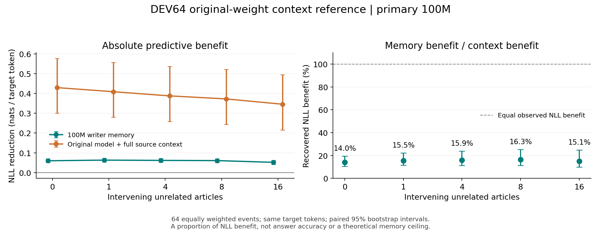

# DEV64：原始权重完整源文章上下文参照

**日期：2026-10-20｜主结果：固定 100M writer｜64 个事件 × 5 个距离，全部完成**

100M writer 的**全文 NLL 收益**约为完整源文章上下文参照收益的 **13.96%–16.32%**；只看首个评分窗，约为 **21.66%–25.95%**。无干扰时，全文比例为 **13.96%［10.50%, 19.45%］**；16 篇干扰文章后为 **15.05%［9.90%, 24.85%］**。方括号为事件配对 bootstrap 的点态 95% 区间。

这是**预测损失改善量的比例**，不是准确率、事实召回率，也不是“存下了多少百分比的信息”。完整源文章上下文是本次测到的参照，不是理论上界。100M 主、65M 次的身份保持不变。

本项是已封存 M1 分析之外的独立增量评测。完整结果、CPU 分析、ZIP 解包复算及增量代码恢复均已通过校验；**本项 B2 增量归档的 8 个对象、34,014,965 字节已完成独立回读**。三组归档的身份与收据见[归档索引](archive_manifest.json)，Core、supplement 原对象及旧分析 ZIP 没有改写。



图中展示全文目标；首评分窗结果见第 4 节。误差条均为事件配对 bootstrap 的点态 95% 区间。

## 1. 参照实际读到了什么

使用与原 DEV64 相同的冻结底座 `Qwen/Qwen3-0.6B`，revision `c1899de289a04d12100db370d81485cdf75e47ca`，BF16、SDPA。模型直接加载原始权重，没有加载 writer、构造记忆适配器或注入记忆；全部参数冻结，不执行优化或反向传播。

对每个事件和距离 `d ∈ {0,1,4,8,16}`，输入为：

```text
早期源文章 A + "\n\n"
+ 原 self 轨迹中同序的前 d 篇干扰文章（每篇后加 "\n\n"）
+ 后续文章 B 的同一个局部评分窗
```

文章分别沿用冻结 token ID，再拼入单独编码的分隔符 `[271]`。不套聊天模板，不额外添加特殊 token。A 与干扰文章保留全文，B 不作为记忆写入材料。

评分目标与旧 DEV64 完全相同：从 `B[128:]` 开始，每窗最多评分 384 个 token，并保留其前面的 128 个 B token。下一窗从目标位置 512、896……继续；每次重新构造输入并清空 KV 状态。**本参照扩展的是 A 和干扰文章的可见上下文，B 仍使用原先的 rolling 128-token 前缀。** 标准因果注意力保证每个目标只能读取它之前的 token。

| 范围 | 实际覆盖 |
|---|---:|
| 独立事件 family | 64 |
| 事件 × 距离单元 | 320 |
| 每个距离的全文目标 token | 52,914 |
| 每个距离的首评分窗目标 token | 22,924 |
| 原始权重 empty 检查 | 64 个事件、173 个评分窗 |
| 完整源文章上下文评分 | 865 个评分窗 |
| 全部 context 输入 token，含各窗重复上下文 | 5,612,316 |
| 最长输入／模型位置上限 | 17,866／40,960 token |

所有输入均在位置上限内，无截断、无滑动窗口。模型的原始 empty 仅运行一次作精度检查；完整 context 也只运行这一组 320 单元，随后在 CPU 上供全部 21 个 writer 检查点复用。

## 2. 比例的定义与统计口径

记事件 `i` 的目标 token 平均损失为 `E_i`（冻结旧 empty）、`S_i`（writer self）和 `C_i`（原始权重 context）。先对事件等权平均，再相除：

```text
记忆收益 G_memory  = mean_i(E_i − S_i)
上下文收益 G_context = mean_i(E_i − C_i)
NLL 收益比例 R      = G_memory / G_context
```

分子和分母使用**同一份冻结旧 empty**。它在 21 个检查点、5 个距离间逐事件完全一致；新跑 raw empty 只用于 sanity check。这里既不是把所有事件 token 混池，也不是先算每个事件的比例再平均。每篇文章内部按目标 token 求均值，之后 64 个事件等权。

本增量分析使用 **10,000 次事件 family 配对 bootstrap，seed 20261020**。同一份抽样矩阵同时用于两个评分范围、全部距离和 21 个检查点，分子与分母保持配对。区间为点态 95%，未进行多重比较校正。本页新算的收益区间使用该 seed；旧报告已发表的区间与数值不作替换。

如分母均值非正，比例点估计不作稳定百分比解释；如分母区间包含 0，则不报告稳定比例区间。负分母 draw 全部保留，零分母 draw 在数组原位置保留为未定义值，不筛掉后重算区间。本次全文和首窗的 **10 个分母区间均严格为正，非正分母 draw 均为 0/10,000**；21 点复用相同分母。

## 3. 100M 主结果：全文目标

全文 empty 的事件等权 NLL 为 **2.953541 nats/token**。以下收益均相对于该共同基线；收益越大表示预测损失降低越多。

| 干扰文章数 | 记忆收益 G_memory［95% CI］ | 上下文收益 G_context［95% CI］ | NLL 收益比例［95% CI］ |
|---:|---:|---:|---:|
| 0 | 0.059966［0.050763, 0.069511］ | 0.429415［0.300542, 0.577011］ | **13.96%［10.50%, 19.45%］** |
| 1 | 0.063221［0.054184, 0.072224］ | 0.408745［0.280207, 0.556703］ | **15.47%［11.39%, 22.15%］** |
| 4 | 0.061801［0.052420, 0.071517］ | 0.387662［0.257968, 0.536069］ | **15.94%［11.34%, 23.91%］** |
| 8 | 0.060779［0.051402, 0.070506］ | 0.372438［0.243168, 0.521328］ | **16.32%［11.37%, 25.21%］** |
| 16 | 0.052022［0.042112, 0.062168］ | 0.345549［0.215957, 0.494645］ | **15.05%［9.90%, 24.85%］** |

从 0 到 16 篇干扰文章，记忆收益点估计由 0.059966 变为 0.052022，上下文收益由 0.429415 变为 0.345549。因此，后者作为分母的变化也会影响比例；**较高的比例不能单独证明记忆的绝对收益提高或遗忘减轻**。本页不根据这些点估计对距离作显著性排名。

## 4. 100M 主结果：首个评分窗

这里的“首窗”严格指 **`B[128:min(512,len(B))]`**，最多 384 个目标 token；不是文章首 token，也不是把后续 B 全文都作为上下文。首窗 empty 的事件等权 NLL 为 **2.937550 nats/token**。

| 干扰文章数 | 记忆收益 G_memory［95% CI］ | 上下文收益 G_context［95% CI］ | NLL 收益比例［95% CI］ |
|---:|---:|---:|---:|
| 0 | 0.064391［0.052550, 0.076768］ | 0.297217［0.198887, 0.412001］ | **21.66%［15.22%, 32.16%］** |
| 1 | 0.067144［0.055338, 0.079325］ | 0.276758［0.178796, 0.391607］ | **24.26%［16.73%, 37.53%］** |
| 4 | 0.064261［0.052086, 0.077042］ | 0.257060［0.159913, 0.371670］ | **25.00%［16.62%, 40.56%］** |
| 8 | 0.062455［0.050638, 0.075055］ | 0.240638［0.144032, 0.354582］ | **25.95%［16.74%, 43.88%］** |
| 16 | 0.052796［0.040027, 0.066065］ | 0.214029［0.117508, 0.327375］ | **24.67%［14.72%, 46.40%］** |

首窗比例点估计高于全文比例，不能据此推断首窗“记住了更多事实”。两种评分范围的上下文收益分母不同，且本分析未将范围之间的差异登记为独立确认性检验。

## 5. 21 点附加表与主次身份

同一个 context 参照在 CPU 上与 0M、5M……100M 的全部冻结 self 结果配对，输出 **21 × 5 × 2 = 210 行**[描述表](context_data/context_recovery_curve.csv)。100M 保持主结果，65M 为次要检查点，其余点仅描述训练曲线，不重新选择最佳权重。

例如，65M 全文比例在 d=0 为 **12.58%［9.48%, 17.50%］**，d=16 为 **15.38%［10.28%, 25.06%］**。这些边际区间不替代 65M−100M 的配对差值检验，也不支持凭高低改换主检查点。完整表同时保留每点实际训练 token 数、E/S/C NLL、分子、分母、区间和分母风险。

## 6. 完整性、运行时间与复算

| 检查项 | 结果 |
|---|---|
| 21 个旧检查点身份 | 路径、文件 SHA、step、训练 token、writer tensor SHA 与冻结清单一致 |
| 旧 empty 全文／首窗 | 跨 21 点和 5 距离逐事件精确相等，容差 0 |
| 新 raw empty 全文／首窗 | 预先固定 NLL 绝对容差 0.0001；实际最大差均为 **0.0** |
| 目标与输入身份 | source token hash、pair、同序 A/D、目标 token 数与逐窗 hash/边界全部匹配 |
| 选取尾部 logits 的校验 | 384 与 217 目标 token 的两项校验均与完整 logits 损失一致，差值 **0.0** |
| 参数与输入文件 | 参数冻结、无梯度、参数对象/版本及输入文件不变；未加载 writer 或构造记忆接口 |
| 原始结果下载 | 10 个成员、4,088,185 bytes 逐文件 SHA256 校验通过 |
| 评测完成时间 | **2026-10-20 06:10:49.312350 UTC** |
| 评测记录 elapsed | **132.112011 秒，约 2 分 12.1 秒** |

elapsed 是本次单进程评测记录的耗时，含模型加载、raw empty 检查与 context 评分；不含之前的 CPU 预检、结果传输和之后的 CPU 分析，也不是单独的 GPU 活跃时间。执行使用 8 个 CPU 线程、确定性算法；`optimizer_steps=0`、`backward_calls=0`。

新增推理代码 commit 为 `e1df5725fd2a4d6c9f523ad024ade3b7eba7a8cc`，独立部署；旧 M1 评测提交与结果保持原身份。关键新增输入：

| 文件 | SHA256 |
|---|---|
| `raw/context.json` | `f522f22d5678ab8d6898e7acd1e032ed4777fcd5a15d1434979e26cc070c10f2` |
| `raw/preflight.json` | `b4fdac956cab2651f2ddeb590f0d1f480304904e134157dfbd56d1c884e0a7bc` |
| 作为共同基线来源的旧 100M DEV64 JSON | `7051e93ad164a90e26623a852b2679e1d9d619809cd14f5aabc69635402c9f0c` |

数据索引采用独立增量 ZIP 的 `raw/`、`analysis/` 布局。B2 前缀为 `b2://clclcl/cl-research/delta-ngram/20261020-dev64-context/`，ZIP 文件为 `m1_dev64_context_addon_20261020.zip`，33,734,735 bytes，SHA256 `68ccdfac0718f6c2fed6d60c525bcaf25b2c03aadb21068a2ce5334f749ff2b9`。该前缀位于旧 Core 前缀之外；完整对象位置见[归档索引](archive_manifest.json)，下载与固定 SHA 预检见[恢复说明](restore.md)。

| 文件 | 内容 |
|---|---|
| `raw/context.json`、`raw/preflight.json` | 完整结果、冻结 token/窗口计划与执行身份 |
| `provenance/download_verification.json` | 本地下载后的逐成员传输校验收据 |
| `analysis/context_recovery_primary100m.csv` | 本页主表的 10 行完整精度数值；[Git 副本](context_data/context_recovery_primary100m.csv) |
| `analysis/context_recovery_curve.csv` | 21 点、5 距离、2 范围的 210 行附加表；[Git 副本](context_data/context_recovery_curve.csv) |
| `analysis/context_recovery_family.csv` | 13,440 行逐检查点／事件／距离／范围数据 |
| `analysis/context_recovery_bootstrap_draws.npz` | 全部 10,000 次抽样计数、分子、分母及配对比例数组；不删除 draw |
| `analysis/context_recovery_summary.json` | 方法、主次表、完整性、精度漂移和实际运行时间；[Git 副本](context_data/context_recovery_summary.json) |
| `analysis/context_recovery_source_manifest.json` | 分析脚本、全部 21 旧输入及新增输入的 SHA256、参数和环境；[Git 副本](context_data/context_recovery_source_manifest.json) |
| `analysis/independent_verification.json` | 独立重算全部 210 行均值/比例、主结果 10 行的全部 10,000 次配对区间，并核对旧 21 份结果 SHA；[Git 收据](context_data/independent_verification.json) |

在保留旧 21 点 JSON 与冻结检查点清单的环境中，可使用[独立 CPU 分析脚本](../../../scripts/analyze_dev64_context_recovery_20261020.py)复算。`INCREMENT` 指向增量包解压根目录，`CURVE_DIR` 指向旧 21 点结果目录，`INVENTORY` 指向冻结清单；新输出目录必须不存在或为空：

```bash
python "$INCREMENT/delta-ngram/scripts/analyze_dev64_context_recovery_20261020.py" \
  --context "$INCREMENT/raw/context.json" \
  --preflight "$INCREMENT/raw/preflight.json" \
  --curve-dir "$CURVE_DIR" \
  --inventory "$INVENTORY" \
  --output-dir "$NEW_ANALYSIS"
```

该脚本只使用 CPU、Python 标准库和 NumPy，不加载模型，也不重跑 GPU 推理。[统计测试](../../../tests/test_dev64_context_recovery_analysis.py)的 7 项检查全部通过，覆盖事件等权均值之比、配对抽样、非正分母处理和不裁剪比例。

独立复核覆盖全部 210 行的均值与比例，以及主 100M 十行的完整 10,000 次配对区间；此外对全部 210 行各抽查了 4 个 draw。它没有对每个附加检查点的所有 draw 再独立重算一遍。

封包后，另在全新目录解开实际 ZIP，并使用包内脚本、包内新增原始结果及逐 SHA 匹配的旧 21 点输入完成 CPU 复算。三个 CSV 的 13,660 行、全部 4,940,210 个 NPZ 数组元素，以及汇总科学字段均与封包结果一致；[解包复算收据](context_data/context_addon_reproduction.json)记录了完整核对范围。它验证打包后可复算，与上一段独立实现的统计复核分开报告。

[B2 回读收据](backup_receipts/context_restore_verification.json)记录：2026-10-20 06:42:15.622648 UTC，独立目录 `/workspace/delta-ngram-dev64-context-restorecheck2-20261020` 中的 8 个对象，逐文件 SHA256、字节数、精确文件集合与独立 inode 全部通过。收据 SHA256 为 `f74c72663c7e0275fe8ee424dee4c7061b5c1215fb2af68612722cee9d1e4b19`。

新增代码通过 supplement 中的完整 bundle 加本次 `dev64_context_delta_20261020.bundle` 恢复：基准为 `fcd056414fd148425940d76c845b39e0ec14e381`，增量终点为 `a5e284febf0b4019379cc1a813d5dac8fef554d4`。[联合恢复收据](backup_receipts/context_git_delta_restore_verification.json)已核对终点、279 个 tree 条目及 38 个变更文件的规范 blob 内容。云端回读收据和本轮收尾文档晚于封存，由后续 Git 提交保存；ZIP 内报告仍保留封存时的“归档待验收”表述，封口中的历史 `false` 字段也不回写。

## 7. 结论边界

- 这项结果比较同一底座、同一目标上的 **NLL 收益**；没有测量问答准确率、事实召回、自由生成质量或信息压缩率。
- 完整源文章上下文付出了更长输入与注意力计算成本；本项没有测量固定时延、显存或算力预算下的优劣，也没有建立理论最优参照。
- 只使用一个训练 seed，区间仅反映本组事件重采样，不涵盖训练随机性、其他事件分布或新 donor 映射。
- 64 个事件与来源身份冻结，不代表能证明底座预训练未见这些内容。长上下文也可能受干扰，分母必须与比例一起解释。
- 本轮没有启动 FINAL、续训、完整 64 事件 QA 或自由生成；旧分析 ZIP 和已封存 Core/supplement 均未改写。
