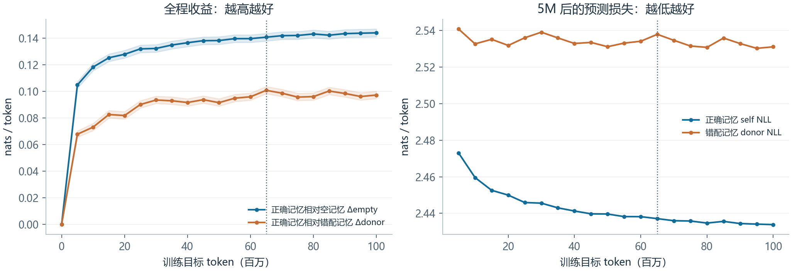
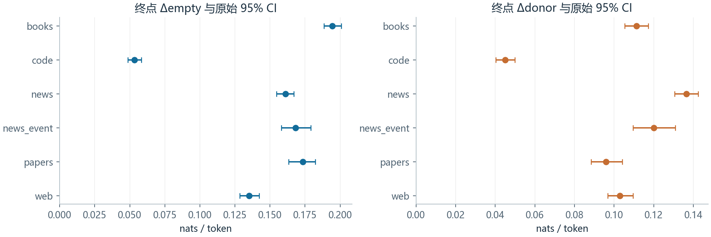
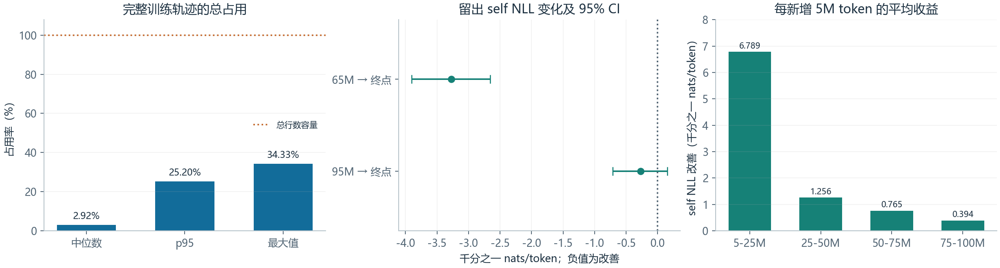
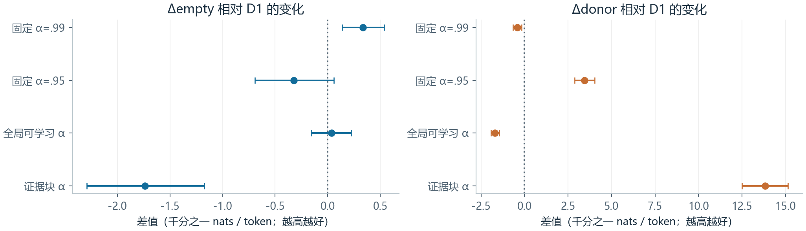
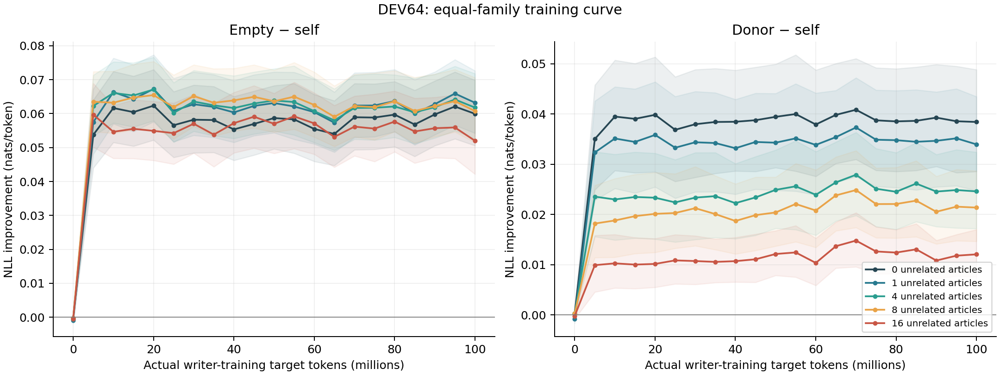
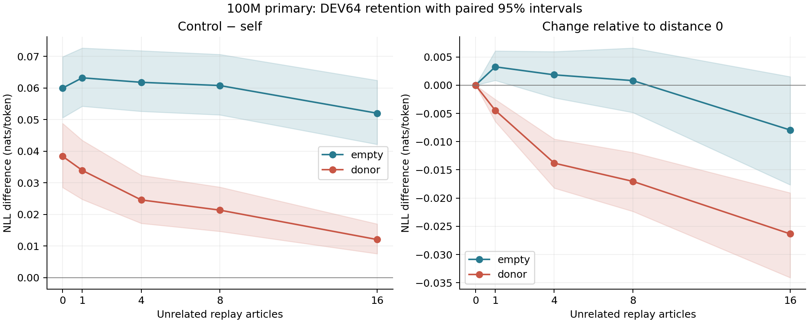
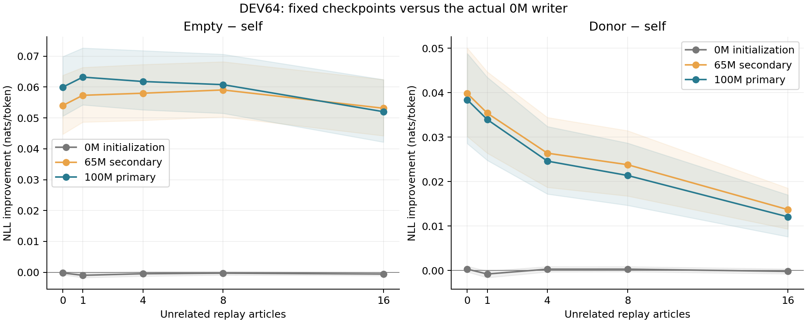
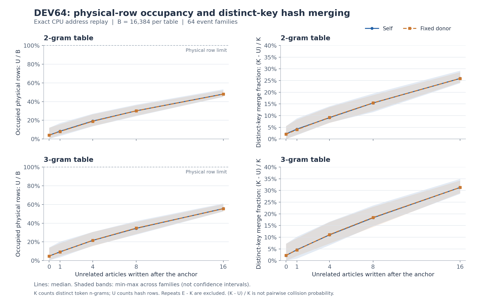

# M1 正式训练与记忆评估报告

**日期：2026-10-20｜主结果：100M 预算终点｜次要结果：65M 原规则选点**

本报告汇总已完成的历史留出评测、5M α 对照、数学诊断与新事件 DEV64。**DEV64 的 0M、5M、10M……100M 共 21 点已全部完成并校验，0 项失败；FINAL 尚未启动。** 100M 为主、65M 为次，其余点用于诊断训练曲线。文中的历史事件首块诊断不属于新 DEV64。

新增的 **DEV64 full-context 原始权重参照已全部完成**，见第 7.7 节及[独立报告](context_reference.md)。增量 B2 归档已独立回读并通过全部 8 个对象的大小、SHA256 与独立文件校验，见[验收收据](backup_receipts/context_restore_verification.json)。旧分析 ZIP 与两组已封存备份不包含该新增结果，也没有改写。

## 0. 实验概览与冻结范围

本次实验检验：**在 reader 参数固定时，离线训练的小型 writer 能否把新文本写入外置 n-gram 记忆，并改善后续文本的预测。** 离线训练通过后续预测损失更新 writer；在线评测固定 reader、writer 参数，只前向更新各条轨迹的记忆状态。预测、写入和新建空表的边界遵循冻结协议。

| 项目 | 本报告对应的已执行配置 |
|---|---|
| 运行标识 | `m1_event_mixture_seed17_20261019`，训练 seed 17 |
| Reader | 冻结 `Qwen/Qwen3-0.6B`，revision `c1899de289a04d12100db370d81485cdf75e47ca` |
| 记忆接口 | `external_hash`；2 阶、3 阶各 16,384 行；注入层配置 `layer_index=1` |
| Writer | 1,190,465 个可训练参数；MLP 隐层 128，右侧证据窗口 4；复用 P1 第零步随机初始化 |
| 写入更新 | D1；每条独立轨迹重新建空表，轨迹内保留跨块反向传播路径 |
| 优化目标 | 按有效目标 token 汇总的 self 交叉熵；训练目标不含 donor 对比项 |
| 优化设置 | AdamW，学习率 0.0003、weight decay 0、梯度裁剪 1.0；batch size 4、梯度累积 3 |
| 文本块 | block size 512，reader prefix 128；来源相关的 2/4/8/16/32 块长度配方 |
| 训练预算 | 名义 100,000,000 个目标 token；实际 99,999,524；4,173 个 optimizer steps；余量 476 |
| 写入与轨迹计数 | 200,001 次块写入，50,075 条轨迹；实际 writer 新 token 101,816,742 |
| 历史评测 | 0M 至 100M 每约 5M 一个点，共 21 点；640 个 family，五类宏平均 |
| 新事件 DEV64 | 21 个检查点 × 64 个事件 × 5 个干扰距离，事件等权；全部完成 |
| 主次检查点 | 100M 主、65M 次；其余点用于诊断，不再择优 |
| 独立 FINAL | 尚未运行；仅允许锁定的 100M 权重执行一次 |

“训练目标 token”“writer 新 token”“原始读取 token”是不同计数，不能互相替代。100M 是主训练的目标 token 上限；第 6 章四组 α 对照各另用相同的 5,013,843 token 前缀，分别记账，不计入主 run 的 99,999,524 token。

训练来源份额在模型评测前冻结；下表的实际计数来自训练终点 summary。普通新闻与报道流合计名义 20%，历史主指标将二者合并为同一新闻类别。

| 来源 | 目标份额 | 实际训练目标 token |
|---|---:|---:|
| code | 20% | 19,998,720 |
| papers | 25% | 25,004,032 |
| books | 20% | 19,998,720 |
| web | 15% | 14,996,992 |
| news | 17.5% | 17,503,744 |
| news_event | 2.5% | 2,497,316 |
| 合计 | 100% | 99,999,524 |

执行配置见 [m1_event_mixture_seed17.yaml](../../../configs/m1_event_mixture_seed17.yaml)，方案与数据划分见[多领域执行计划](../../multidomain_execution_plan_20261019.md)，主次身份与扩展范围见[检查点登记](../../m1_checkpoint_policy_20261020.md)和[21 点追加登记](../../m1_dev64_curve_registration_20261020.md)。配置 SHA256 为 `aa4319dd172b545563e705f644c167675c0c6ebede9cd7be5ed9d5018519530a`。

### 运行环境与代码身份

M1 使用单设备训练；终点记录为 `native_adapter=false`、`ddp=false`、`time_parallel_scan=false`。已留存的 GPU 环境验收记录报告设备为 RTX 4090、约 48 GB 显存；M1 启动预检记录 `torch 2.14.1+cu132`、CUDA 13.2，并验证 reader 无梯度、writer 梯度可达。该预检没有更新 optimizer，不作为效果证据。环境验收背景见[训练计划](../../training_plan_20261019.md)；逐文件身份见[恢复索引](archive_manifest.json)。

**本报告绑定 M1 的冻结实现。** 正式分析包中的评测与回放源码来自 commit `167d24783161be7842bbb9aec52f2c7804191ba9`；writer、D1 更新、训练核心等文件与实际训练日志记录的源码 SHA256 已核对。包内分析脚本的身份由成员清单另行记录，不能以当前仓库 HEAD 代替原评测版本。

**后续 Qwen3.8-Flash-Next 原生 writer 是独立工程原型，不属于本次 M1 训练、DEV64 结果或效果结论。** 本报告不把外置小模型结果推广为原生接口已经训练或通过评测。P1/P2 只作背景索引，详见 [P1 诊断](../../p1_diagnostics_results_20261019.md)、[P2 结果](../../p2_results_20261019.md)。

## 1. 当前结论与检查点登记

当前证据支持：**writer 学到的写入方式能改善新事件的续写预测；DEV64 的大部分收益在首个 5M 已出现，5→100M 随后波动，未呈单调持续改善。** 固定的 65→100M 比较在历史留出及新事件无干扰条件下仍支持改善。长干扰后的事件相关优势仍为正，但会衰减；表没有写满，哈希干扰却不能排除。长距离继续训练的增益尚不确定，详见第 7 章。

M1 已走完预算允许的完整训练轨迹：step 4173，实际 **99,999,524** 个训练目标 token。剩余 476 token 不足下一条完整轨迹，因此 `budget_endpoint=true`；`complete=false` 表示未精确填满 token 预算，并非异常中断。

| 用途 | 检查点 | 实际训练目标 token | 宏平均 self NLL ↓ | Δempty ↑ | Δdonor ↑ |
|---|---|---:|---:|---:|---:|
| **主结果** | 100M／step 4173 | 99,999,524 | **2.433845** | **0.143996** | 0.097197 |
| 次要结果 | 65M／step 2713 | 65,009,696 | 2.437119 | 0.140722 | **0.100762** |

原登记规则是在合格检查点中最大化 Δdonor，选中 65M；该规则与结果完整保留。用户现登记 **100M 为后续评测主检查点，65M 为次要结果**，决定发生在这两个指定检查点的新事件 DEV64 及任何 FINAL 评测之前。决定参考了历史曲线，不能称为历史评测完全没有选择影响。

用户随后将原两点计划扩展为 21 点 DEV64 曲线，使用同一冻结数据和协议并行评测；此扩展不改变 100M 主、65M 次的身份，其余点只作诊断。原登记保留，扩展范围以新增曲线登记为准。FINAL 仅允许使用已锁定的 100M 权重执行一次，不根据后续分数换检查点；本轮不启动 FINAL。详见[检查点登记](../../m1_checkpoint_policy_20261020.md)。

<a id="historical-curve"></a>

## 2. 图一｜历史留出：预测继续改善，donor 差距有波动



**读图：**左图蓝线是正确记忆相对空记忆的收益，整体上升、后期变缓；橙线是正确记忆相对错配记忆的差距，波动更明显。右图蓝线的 self NLL 持续总体下降，说明实际预测改善。竖虚线标记原规则选出的 65M，**不代表当前主检查点**。

NLL 是真实目标 token 的平均负对数概率，单位为 nats/token，越低越好。self 使用本任务记忆，empty 不写记忆，donor 写入其他任务的匹配材料：

$$
\Delta_{\rm empty}=L_{\rm empty}-L_{\rm self},\qquad
\Delta_{\rm donor}=L_{\rm donor}-L_{\rm self}.
$$

21 次评测覆盖初始点及约每 5M 一个检查点，均使用相同 **640 个 family、1,419,686 个目标 token**；样本、协议、donor 哈希全部一致。统计先在类别内按目标 token 加权，再对五大类等权平均。`news` 与 `news_event` 合并为新闻类，后者在该类中的目标 token 权重为 **35.50%**。

65→100M，self NLL 下降 **0.003274**，donor NLL 下降更多，为 **0.006839**；所以 Δdonor 缩小 **0.003565**。直接原因是错配基准追近，不是自身预测损失上升。65M 是 **35M–100M** 已评估点中 donor NLL 最高的点；若包含 30M，最高点是 30M。

65M 的 Δdonor 优势与相邻点变化幅度同量级，但不能称为“纯噪声”：65M−100M 的探索性配对区间为 **[0.002768, 0.004340]**，未跨零。选择 100M 体现对自身预测与预算终点的重视，而非否定 65M 的原指标优势。

<a id="source-results"></a>

## 3. 图二：100M 的收益覆盖哪些来源



**读图：**两幅图所有误差线都在零右侧，六个来源对 empty、donor 均有正收益。相对空记忆，books 的收益最大，code 最小；相对 donor，普通 news 的差距最大。误差线反映各来源的条件比较，不能据此直接判定来源之间差异显著。

| 来源 | family 数 | Δempty | Δdonor |
|---|---:|---:|---:|
| books | 64 | 0.194523 | 0.111281 |
| code | 64 | 0.053352 | 0.044992 |
| news | 320 | 0.160951 | 0.136598 |
| news_event | 64 | 0.168227 | 0.120110 |
| papers | 64 | 0.173400 | 0.095998 |
| web | 64 | 0.135172 | 0.102970 |

六行供观察来源差异，不能直接等权平均为主指标。100M 五类宏平均 95% 区间：Δempty **[0.141032, 0.146910]**；Δdonor **[0.094557, 0.100069]**。这些是续写概率收益，不是事实记忆率或问答正确率。

<a id="capacity-writer-audit"></a>

## 4. 图三：容量与 writer 的数学检查



**读图：**容量面板应与 100% 边界比较；中间面板的损失差越负越好，65→100M 区间完全在零左侧，95→100M 则跨零；边际收益面板显示后期每增加 5M token 的平均收益变小。

### 表是否写满

2 阶、3 阶各有 16,384 行，每条独立轨迹共 32,768 行。完整训练日志覆盖 **200,001 次写入、50,075 条轨迹**；终态总占用中位数 **2.92%**、p95 **25.20%**、最大 **34.33%（11,248 行）**。总行数最大值还低于一张表的容量，因此任一单表也没有写满。

每条轨迹重新建空表，训练 token 不会持续堆进同一张表。地址只取决于 token 和固定哈希配置；65M 与 100M 在同一固定评测上的占用与冲突位置相同。因此，“训练久了把表塞满”不能解释此次变化。

但低占用不排除哈希干扰。写入次数 \(E\)、不同真实 key 数 \(K\)、不同桶数 \(U\) 满足 \(E-U=(E-K)+(K-U)\)：重复 key 与真正碰撞不能混算。日志缺少 \(K\)，不能推断碰撞率。

行更新在门控 \(0\leq\beta_i\leq1\) 时是旧值与目标向量的凸组合，因此目标有界时不会靠反复相加无界累积；这不证明目标向量始终有界，也不证明完整梯度链收缩。

### writer 是否过拟合或已经饱和

令 \(d=L_{\rm later}-L_{\rm earlier}\)，检验 \(H_0:d\geq0\)，改善方向为 \(d<0\)。

| 比较 | self NLL 差值 ↓ | 配对 95% CI |
|---|---:|---|
| 65→100M | −0.00327383 | [−0.00390194, −0.00265769] |
| 95→100M | −0.00027141 | [−0.00071447, +0.00015309] |

65→100M 六个来源的 self NLL 点估计均改善，宏区间支持整体改善；但最后约 5M 的正收益尚不能确认。每增加 5M 的平均 self-NLL 改善由 **50→75M 的 0.000765** 降至 **75→100M 的 0.000394**，约减半。

训练实际最小化 self 交叉熵，没有 donor 对比损失，因而 self 风险下降不必使 Δdonor 上升。完整 4,173 步训练日志已按目标 token 加权；训练例子不断变化，且缺少分来源训练 loss，不能把混合训练曲线与不同权重的验证曲线相减来证明过拟合。

**结论：没有观察到整体留出性能退化，存在边际收益趋缓；既不能断言硬饱和，也不能保证继续训练永远有正收益。**

### 为什么排除这两项仍不能保证以后每步都受益

令 \(R(\theta)\) 为留出风险，\(u\) 为 AdamW 实际产生的一步参数变化。若该局部区域的风险梯度满足平滑常数 \(L\)，则：

$$
R(\theta+u)-R(\theta)
\leq \nabla R(\theta)^\top u+\frac{L}{2}\lVert u\rVert^2.
$$

要由此保证改善，右侧必须小于零：训练更新既要沿着降低留出风险的方向，也不能步幅过大。表未满、过去没有观测到过拟合，都不能确定这个内积与曲率项的符号和大小。保存日志中的非零训练梯度也无法代替它们。因此，本次数学检查能支持“已观察区间内仍有收益”，无法推出“未来训练量无限增加仍必然受益”。

<a id="cross-article"></a>

## 5. 跨文章首块：旧记忆的帮助仍在增加

历史 `news_event` 首块诊断覆盖 **64 个 family、75 篇后续文章**。评分时当前文章尚未写入记忆；full 从本地 BOS/EOS 预测首块，after-prefix 给出真实前 128 token 后评分，二者输入约定不同。

| 100M 首块诊断 | Δempty | Δdonor |
|---|---:|---:|
| full | 0.147817 | 0.114739 |
| after-prefix | 0.143102 | 0.110089 |

四项原始区间均为正。65→100M，full 首块 Δdonor **增加 0.003996**，after-prefix 增加 **0.005332**。相反，文章后续块的 Δdonor 减少 **0.009998**：self NLL 仅改善 0.000178，donor 改善 0.010177。

这将差距收缩定位到后续块。此时当前文章的已读部分可写入记忆，不能把整条轨迹的差距变化直接等同于跨文章能力退化。错配记忆更有用，可能涉及领域统计或通用表示校正；仅凭 NLL 无法确定具体机制。

<a id="alpha-ablation"></a>

## 6. 图四：5M α 对照的取舍



**读图：**横轴单位是**千分之一 nats/token**，零线表示与 D1 相同；左右分别是 Δempty、Δdonor 的变化。证据块 α 在右图明显更高，在左图却更低，不能只看右图宣布整体胜出。

四组 α 均完成与 D1 相同的首个 5M 前缀：实际 **5,013,843 token、210 步**，初始化／前缀身份及历史验证样本、donor 一致。

| α 相对 D1 | Δempty 变化 | Δdonor 变化 |
|---|---:|---:|
| 固定 .99 | +0.000334 | −0.000425 |
| 固定 .95 | −0.000322 | +0.003454 |
| 全局可学习 | +0.000035 | −0.001698 |
| 证据块 | −0.001737 | +0.013835 |

证据块 α 的 self NLL **变差 0.001737**，donor NLL **变差 0.015571**，后者更大，扩大了两者差距。固定 .95 与全局 α 的 Δempty 差值区间跨零；固定 .99 的小幅预测改善伴随 donor 差距减小。目前不存在两项指标全面领先的方案。

<a id="dev64"></a>

## 7. 新事件 DEV64：21 点完整曲线

本节全部 **21 个检查点均完整评测 64 个事件**。每个事件先写入较早文章，再插入 **0、1、4、8、16 篇无关文章**，预测后续文章。目标文章始终不写入表。输入提供真实前 128 token，后续按 teacher forcing 评分，即预测时可看到此前真实 token。本结果衡量续写概率，尚不衡量自由生成或问答正确率。

**统计口径与历史评测不同：**新 DEV64 先在每个事件内平均目标 token 的 NLL，再对 **64 个事件等权平均**。每个距离评分 52,914 个目标 token；不能把这些数值与历史五类宏平均直接比较大小。

本章原始整体、距离变化、方向及 prefix 分组区间，均使用 **10,000 次事件 family bootstrap，seed 20261019**；同一比较中按事件配对。新增 100M−65M 比较使用 **10,000 次、seed 20261020**。这里没有历史五类分层；区间均为点态，未对多个检查点、距离和对比作整体校正。

### 7.1 完整曲线：首个 5M 收益明显，随后波动



**读图：**左右分别为 Δempty、Δdonor，不同颜色表示干扰文章数。收益在 0→5M 快速出现，5M 已达到与后续检查点相同的量级；5→100M 继续波动，75→100M 也没有持续单调上升。100M 主、65M 次的身份保持固定，不能从曲线重新挑选主结果。

5→100M 的已测点中，无干扰 Δempty 为 **0.053763–0.062354**，16 篇干扰时为 **0.052022–0.059701**；Δdonor 分别约为 **0.0350–0.0408** 和 **0.0099–0.0148**。这些范围描述曲线形状，不是对最优点、收敛或相邻点显著差异的检验。

所有已训练检查点在 16 篇干扰时的 Δdonor 都低于各自无干扰点；Δempty 则不严格按干扰距离排序。相对空表的收益包含非事件特异部分，不能把 Δempty 全部解释为事件特异记忆。固定 65→100M 的配对比较见 7.3 节，不将局部比较推广为整段训练持续改善。

### 7.2 100M 的记忆收益与保留



**读图：**左图中，100M 在所有距离均优于 empty 和 donor；相对 donor 的优势随干扰文章增加而下降。右图按同一事件配对比较距离变化：donor 曲线的区间落在零以下，支持事件相关优势衰减；empty 曲线到 16 篇时的区间跨零，尚不能确认相对空表的收益下降。

| 100M 条件 | Δempty [95% CI] | Δdonor [95% CI] |
|---|---|---|
| 无干扰文章 | 0.059966 [0.050586, 0.069878] | 0.038407 [0.028549, 0.048825] |
| 1 篇干扰文章 | 0.063221 [0.054235, 0.072658] | 0.033948 [0.024768, 0.043461] |
| 4 篇干扰文章 | 0.061801 [0.052623, 0.071803] | 0.024594 [0.017187, 0.032396] |
| 8 篇干扰文章 | 0.060779 [0.051499, 0.070635] | 0.021364 [0.014647, 0.028665] |
| 16 篇干扰文章 | 0.052022 [0.042169, 0.062426] | 0.012059 [0.007572, 0.016996] |

16 篇相对无干扰，Δdonor 下降 **0.026347**，变化区间 **[−0.034105, −0.019073]**；Δempty 变化 **−0.007944 [−0.017661, +0.001509]**。因此，正确早期文章的优势仍在，事件区分度已有衰减。不能把全部 empty 对照收益都解释为事件特异记忆。

### 7.3 65→100M：短距离改善，长距离差异尚不确定



**读图：**0M 的收益接近零；训练后的 65M、100M 明显更高。无干扰时，100M 的 Δempty 高于 65M；16 篇时两者接近。图上各自区间的重叠不能代替配对差值检验，以下表为准。

| 指标，全部为 100M−65M | 无干扰：差值 [95% CI] | 16 篇干扰：差值 [95% CI] |
|---|---|---|
| self NLL，负值更好 | **−0.005954 [−0.008499, −0.003372]** | +0.001115 [−0.002684, +0.004916] |
| donor NLL，负值更好 | −0.007361 [−0.009392, −0.005403] | −0.000511 [−0.004143, +0.003001] |
| Δdonor，正值更好 | −0.001407 [−0.004454, +0.001658] | −0.001625 [−0.004191, +0.000828] |

无干扰时，自身预测继续改善；donor 改善更多，缩小了两者差距，但差距变化区间跨零。16 篇时三项变化均未确认方向。**新数据不支持 writer 已整体学坏，也不支持所有干扰长度下继续训练都有确定正收益。**上述比较为探索性、未作多重比较校正；不会改变 100M 主检查点登记。

0M 并非理论上的空表：它是实际随机初始化 writer。其无干扰 Δempty/Δdonor 为 −0.000219/+0.000290，16 篇时为 −0.000573/−0.000224；其中 16 篇的 Δempty 区间略低于零，因此不能把它写成严格无效应。

### 7.4 方向与 prefix 控制

将读出向量通道置换，保留向量范数，改变其方向；三个固定置换种子先在每个事件内平均，样本数仍为 64。定义方向效应为置换后的 NLL 减原方向 NLL。

100M 无干扰时，self 与 donor 的方向效应分别为 **0.101134、0.032816**；两者之差 **0.068318 [0.050981, 0.086820]**。16 篇时，两者之差仍为 **0.032416 [0.022857, 0.042651]**。这支持读出方向承载有用信息，且正确文章具有额外作用；尚不能据此认定具体事实被正确回忆。

输入 prefix 已重述信息的事件为 **34 个**，未重述 **30 个**。16 篇时，两组 Δdonor 分别为 **0.010800 [0.004758, 0.017008]** 和 **0.013487 [0.006984, 0.021087]**，收益不限于已重述组。没有组间差异检验，不能宣布某一组更强。

### 7.5 长干扰下的表容量：未满，但存在冲突



**读图：**左列的占用随干扰增加，但远未达到 100%；右列的哈希合并比例已明显增加。阴影是事件间的最小至最大范围，不是置信区间。3 阶表的占用和 key 合并通常高于 2 阶表。

历史轨迹最大占用 34.33% 不能外推到本节。对新 DEV64 的 **82 篇去重写入文章，共 78,343 token** 做了 CPU 精确地址重放，逐块核对 **156,686 个地址位置**，并核对全部 **640 个事件×距离×self/donor 写入预算**。

审计使用评测时的冻结源码，已核对 **全部 21 个注册检查点**的地址配置、源/token 哈希及逐格写入预算一致。因此同一套 E/K/U 统计覆盖本次完整曲线。它是精确地址重放，不是评测期间的物理行日志；未重放神经网络值、门控或损失。

16 篇干扰时，self 总占用中位数 **51.77%**、最大 **57.17%（18,734/32,768）**；任一单表最大 **61.13%（10,016/16,384）**。因此，这批评测没有物理行写满。

但真正的 key 合并已经存在：16 篇时，self 的 `(K−U)/K` 中位数在 2 阶为 **25.89%**，3 阶为 **31.28%**。它表示不同真实 key 经过哈希后损失的独立地址比例，**不是 key 对碰撞概率，也不是错误记忆率**。物理表未满并不能排除覆盖与干扰；现有数据也不足以把 Δdonor 衰减单独归因于哈希碰撞。

一个直观的数学参照：若 \(K\) 个不同 key 独立、均匀地哈希到 \(B\) 行，

$$
\mathbb E[U]=B\left[1-\left(1-\frac1B\right)^K\right].
$$

最大占用案例的 3 阶表有 **15,351 个 key、10,016 个已用行**，独立地址减少 **34.75%**；上述理想模型预期约 **35.09%**。所以行占用只有 61.13% 时，出现较多 key 合并完全可能。此模型只是参照，不证明实际哈希独立均匀，也不建立碰撞与预测损失之间的因果关系。

### 7.6 完整性核验与运行时间

21 份完整原始结果、runner 记录、传输归档及成员 SHA256 均已校验。所有检查点的权重身份、step、训练 token 数、writer tensor 哈希和固定数据身份通过核对；**empty 条件的 NLL、loss_sum、目标 token 数逐格精确一致**。总体与两个非空 prefix 子组的均值和原始 bootstrap 区间均从 per-family 数据独立复算并吻合。

正式输出为 **105 行检查点×距离总体结果、210 行 prefix 子组结果、6,720 行检查点×事件×距离结果、21 行运行记录**；均标记 `preview_only=false`。prefix 分组始终为已重述 34、未重述 30、未知 0。

| 时间口径 | 结果 |
|---|---|
| 队列开始／完成（UTC，2026-10-20） | 03:54:15.680096／04:57:37.336767 |
| 完整队列墙钟时间 | **3,801.656671 秒，即 63 分 21.7 秒** |
| 21 项 evaluation elapsed 总和 | 13,274.157121 秒，即 3 小时 41 分 14.2 秒 |
| 单项 evaluation elapsed | 585.050771–672.995915 秒 |

队列启动配置为 4 个 worker、每个 8 个 CPU 线程，并发上限为 8；上限不表示实际使用过 8 个。并发项的 elapsed 总和不能当作墙钟时间、GPU 活跃时间或账单耗时。本轮全部是纯评测，`optimizer_steps=0`、`backward_calls=0`。

### 7.7 原始权重完整源文章上下文参照

新增评测让同一冻结底座直接读取早期文章 A 和同序干扰文章的全文，再预测与旧 DEV64 相同的 B 目标；B 继续使用每窗 128-token 前缀、最多 384 个目标 token。全部 **64 事件 × 5 距离**完成，原始权重 empty 与旧基线的全文及首窗 NLL 最大差均为 0。该参照仅运行一次，在 CPU 上供 21 个 writer 检查点复用。

100M 主检查点的全文记忆收益约为该完整上下文收益的 **13.96%–16.32%**。无干扰时为 **13.96%［10.50%, 19.45%］**，16 篇干扰文章后为 **15.05%［9.90%, 24.85%］**；首评分窗对应为 **21.66%［15.22%, 32.16%］** 和 **24.67%［14.72%, 46.40%］**。比例使用同一冻结 empty 作共同基线，按 64 个事件等权求两项收益均值后相除；区间由同一组 10,000 次事件配对抽样得到，seed 20261020，未作多重比较校正。

这是 **NLL 收益比例，不是准确率或事实召回率**。完整上下文收益也会随干扰变化，因此比例较高不能单独证明记忆绝对收益更大；该参照不是理论上界。详见[完整方法、主表、首窗表和运行记录](context_reference.md)及[21 点附加表](context_data/context_recovery_curve.csv)。100M 主、65M 次的身份保持不变，旧分析数值和区间不替换。

<a id="scope"></a>

## 8. 完成状态与未执行范围

| 项目 | 状态／允许结论 |
|---|---|
| 历史 M1 21 点与四组 α 历史评测 | 完整，可用于本报告 |
| 新事件 DEV64：0M＋5M 至 100M，共 21 点 | **全部完成，21/21；0 失败；身份、统计与传输校验通过** |
| 新 DEV64 精确地址容量审计 | 完成；全部 21 点容量输入身份一致，640 个写入条件 |
| 新增 DEV64 full-context 原始权重参照 | 全部完成；320 单元及 21 点 CPU 配对分析通过；增量 B2 的 8 个对象独立回读验收通过 |
| 旧 D1 首个 5M 的 DEV64 基线 | 随 α 队列在 **40/64** 停止；无完整结果或可用分数 |
| 更早 2 事件运行 | 仅流程检查 |
| α 补充续写、修订、裁剪套件 | 已取消，不据历史分数补写结论 |
| FINAL | 未启动；仅锁定 100M 一次 |

## 9. 统计限制与数据索引

历史评测的原始区间使用 **2,000 次 family bootstrap**；历史新增比较按同 family、同类别配对重采样，seed **20261020**、**10,000 次**。新 DEV64 使用第 7 章说明的事件等权与 10,000 次重采样口径。只运行一个训练 seed，donor 映射固定；区间不覆盖训练随机性或重新选择 donor 的不确定性。事后比较未校正选点或多重检验，不能当作完全独立的确认性检验。历史留出不保证底座预训练未见；P1 多 seed 门槛与 P6 尚未完成。

本仓库保存原报告和八张正式图；新增 context 参照的图表与数据索引见[独立报告](context_reference.md)。下表路径均相对于旧分析包内的 `delta-ngram-runs/m1_analysis_20261020/`，原始结果与派生 CSV 通过归档提供；其大小与 SHA256 见[完整成员清单](analysis_package_manifest.json)。下载与恢复入口见[归档索引](archive_manifest.json)及第 10 章。

| 内容 | 可复查文件 |
|---|---|
| 全部 21 点、主次指标 | m1_series.csv（`data/m1_series.csv`）、report_summary.json（`data/report_summary.json`） |
| 100M 六来源 | endpoint_per_source.csv（`data/endpoint_per_source.csv`） |
| α 与配对差值 | alpha_first5M_comparison.csv（`data/alpha_first5M_comparison.csv`）、paired_contrasts.csv（`data/paired_contrasts.csv`） |
| 首块与后续块分解 | first_block_series.csv（`diagnostics/first_block_series.csv`）、event_65m_to_100m_partitions.csv（`diagnostics/event_65m_to_100m_partitions.csv`） |
| 容量、writer 数学检查 | mathematical_checks_summary.json（`diagnostics/mathematical_checks_summary.json`）、mathematical_capacity_audit.json（`diagnostics/mathematical_capacity_audit.json`）、mathematical_audit.json（`diagnostics/mathematical_audit.json`） |
| 训练与边际收益 | training_intervals.csv（`diagnostics/training_intervals.csv`）、marginal_gain_intervals.csv（`diagnostics/marginal_gain_intervals.csv`） |
| 输入与输出 SHA-256 | 分析清单（`data/source_manifest.json`）、诊断清单（`diagnostics/source_manifest.json`） |
| 新 DEV64 完整曲线与配对差值 | 正式汇总（`dev64_data/dev64_summary.json`）、105 行曲线（`dev64_data/dev64_checkpoint_distance_curve.csv`）、配对比较（`dev64_data/dev64_paired_checkpoint_comparisons.csv`） |
| 新 DEV64 逐事件与 prefix 子组 | 6,720 行逐事件数据（`dev64_data/dev64_family_distance_results.csv`）、210 行子组数据（`dev64_data/dev64_prefix_group_results.csv`） |
| 新 DEV64 运行记录与输入身份 | 21 项运行时间（`dev64_data/dev64_runtime.csv`）、来源 SHA256 清单（`dev64_data/dev64_source_manifest.json`） |
| 新 DEV64 精确占用与哈希合并 | 容量逐事件数据（`dev64_data/capacity_family_distance.csv`）、容量核查范围（`dev64_data/capacity_scope_note.json`） |
| 理想均匀哈希数学参照 | 计算与假设（`dev64_data/uniform_hash_reference.json`） |

本报告及数据包保留 100M 主、65M 次的登记和完整历史分析。包内提供原始评测、派生表格、图与分析脚本，可在 CPU 上重算主要数值统计。评测依赖的模型、源文章和 tokenizer 未打包；历史容量的两个大型原始输入及权重位移审计所需权重也作为外部依赖列明。包中的评测源码固定为 commit `167d24783161be7842bbb9aec52f2c7804191ba9`，后续原生 writer 修改不混入本次分析。

<a id="backup"></a>

## 10. 归档、复算与恢复索引

### 10.1 已核验分析包

正式分析包为 `m1_analysis_bundle_20261020.zip`，大小 **27,767,060 bytes**，SHA256：

```text
e9cad1aea3cf5a7e90a6ec55da57026aa1cefedc9f7682e6cd1ca314be11cb40
```

它包含 **167 个有效载荷文件**及完整的 21 点 DEV64 结果。独立目录中的 portable 验证已通过：校验全部成员后，以 CPU 重算历史分析、终点诊断和 DEV64 统计；21 份 CSV 重生成、2 份容量 CSV 保留，共核对 **23 份 CSV、174,385 个单元格**和 3 份汇总 JSON，数值容差 `1e-12`；48 个原始输入文件的 SHA256 保持不变。核验摘要见[复算收据](reproduction_receipt.json)。

这次 portable 验证没有重新执行 GPU 模型推理，也没有重跑依赖外部数据或权重的容量、参数位移审计。归档标签 `stage=final` 表示**分析包完成版**，不表示执行过封存的 FINAL 测试。

### 10.2 下载与完整恢复状态

**主体 B2 备份已验收：1,733 个对象、23,885,567,983 字节；从云端恢复到独立目录后，全部 SHA256、大小与上传前封口清单匹配。** [核验收据](backup_receipts/core_restore_verification.json)同时确认所有恢复文件与源暂存文件使用不同 inode。该验证没有重新运行 GPU 模型。

**补充 B2 备份也已验收：20 个对象、1,235,103,051 字节；两组合计 1,753 个对象、25,120,671,034 字节。** [补充回读收据](backup_receipts/supplement_restore_verification.json)确认精确文件集合、全部 SHA256、大小及独立 inode，完成时间为 2026-10-20 05:56:17.804734 UTC。分开下载和校验两份归档的命令见[恢复说明](restore.md)。

| 归档内容 | 当前状态 | 身份与入口 |
|---|---|---|
| 训练数据、源文章、M1 tokenizer/底座、历史运行记录 | B2 上传及全量独立回读通过 | `b2://clclcl/cl-research/delta-ngram/20261020-rtx4090/` |
| writer 与完整训练恢复状态 | 112 个 `.pt` 文件在已核验主体内；含全部 M1 检查点及 optimizer 状态 | [主体摘要](backup_receipts/core_backup_summary.json)、[归档索引](archive_manifest.json) |
| 完整分析包、代码 bundle 与 P2 Base 底座补充 | B2 上传及全量独立回读通过，20 个对象 | `b2://clclcl/cl-research/delta-ngram/20261020-rtx4090/supplement/`；[补充回读收据](backup_receipts/supplement_restore_verification.json) |
| GitHub 代码 | 已推送并核验远端 commit `fcd056414fd148425940d76c845b39e0ec14e381` | [代码分支](https://github.com/af-74413592/delta-ngram/tree/codex/raw-text-training)；[Git bundle 恢复核验](backup_receipts/code_bundle_restore_verification.json) |

100M 主权重 SHA256 为 `20b2bef8788d6c3c5c65e22eef3646d220aea01905193d42e99028e19b7f8c1d`；65M 次权重为 `86b044f39eea131f5b8120133f80e22e181ccbc8c93540e51f22e3404d4b1b71`。仅有 writer 权重不能替代包含 optimizer、sampler、计数和 RNG 的完整训练恢复点。Python/CUDA 环境记录了版本与包清单，未归档全部安装包。

补充包的代码快照固定为 `fcd056414fd148425940d76c845b39e0ec14e381`；本报告、恢复说明与最终回读收据在后续 Git 提交中保存。补充回读收据产生于封存之后，因此不在自身所验证的 B2 包内。[封口原件](backup_receipts/supplement_COMPLETE.json)保留封存时的 `b2_restore_verified=false`，最终成功状态由上述独立回读收据证明，不回写封存文件。新增 full-context 参照的执行与归档状态须另行记录。

### 10.3 CPU 复算入口

取得并校验上述 ZIP 后，解压到独立目录，从解压根目录执行：

```bash
python verify_bundle.py
python delta-ngram/scripts/analyze_m1_results_20261020.py
python delta-ngram/scripts/diagnose_m1_endpoint_20261020.py
python delta-ngram/scripts/analyze_m1_dev64_curve_20261020.py --no-figures
```

要求 Python 3.11 或更高版本；历史数值分析使用标准库，DEV64 数值分析另需 NumPy。可选重绘需要 Matplotlib，中文历史图还需本机提供中文字体。脚本会重写解压副本中的派生输出，保留原始评测输入。

依赖边界如下。历史容量与权重位移所需的六项外部输入，其预期恢复相对路径和 SHA256 见成员清单的 `external_inputs`。DEV64 的源文章与 token 身份见包内 `dev64_data/capacity_scope_note.json` 和原始评测 manifest；这些外部输入已在主体 B2 备份中保存，下载对象与路径映射见[归档索引](archive_manifest.json)及[恢复说明](restore.md)：

- 历史容量重放另需 `block_metrics.jsonl.gz` 和 `data_manifest.json` 两个大型原始文件。
- writer 位移审计另需 65M/100M 的 writer 与 training 权重、PyTorch，并调整原脚本路径。
- DEV64 地址重放另需冻结源文章、匹配 tokenizer、PyTorch 与 Transformers；不需要 GPU 模型权重。
- DEV64 重新推理另需冻结模型、源文章、配置与评测代码。恢复备份或复算统计不自动启动新的评测，更不启动 FINAL。

本仓库版本保留已验收分析的全部正文结论、数值和置信区间；新增实验概览与恢复说明，调整数据索引和相对链接，未改写原分析包。
